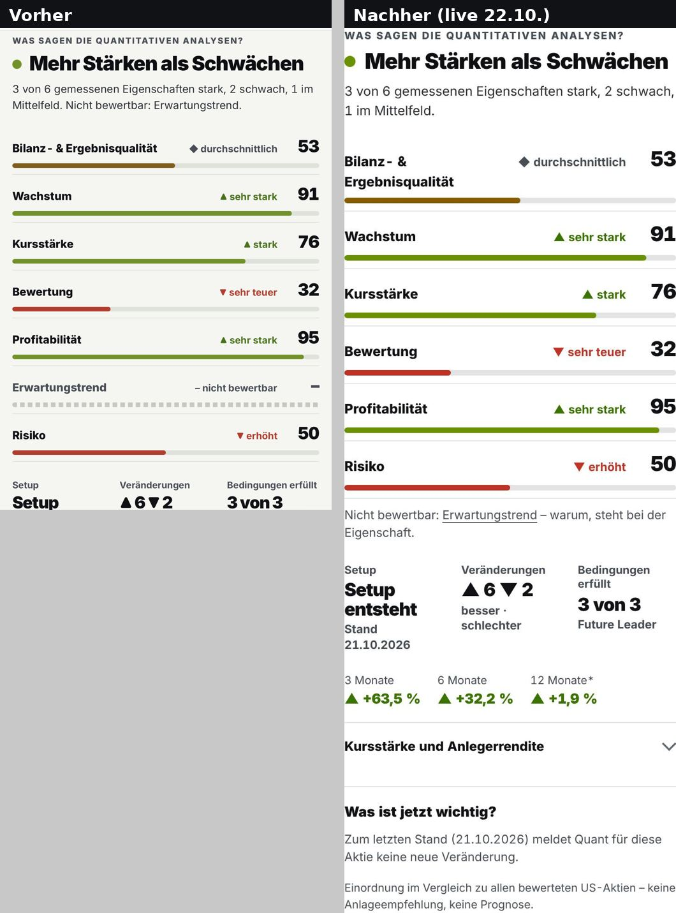
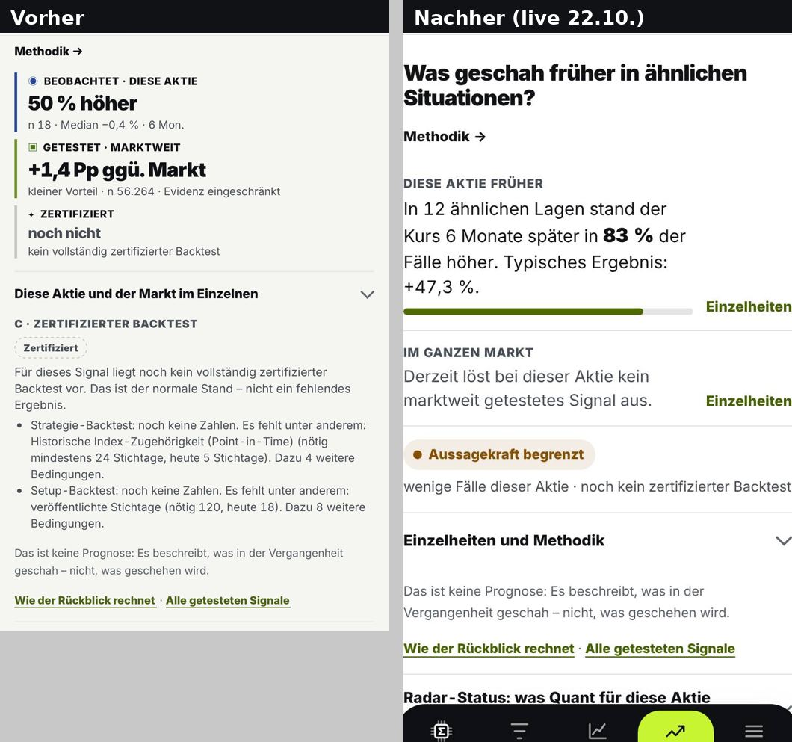
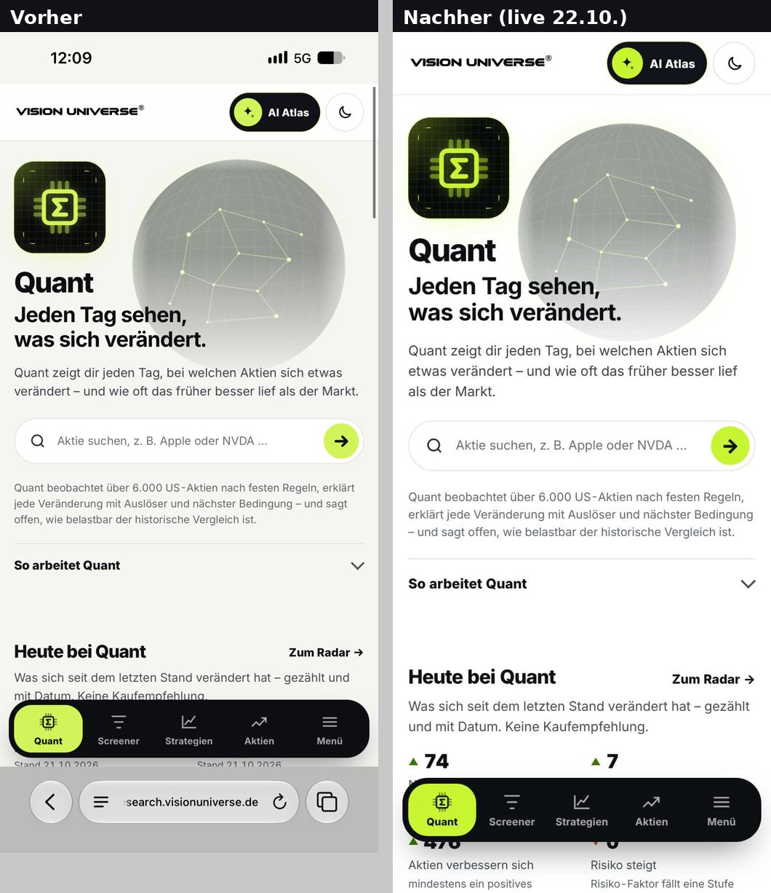
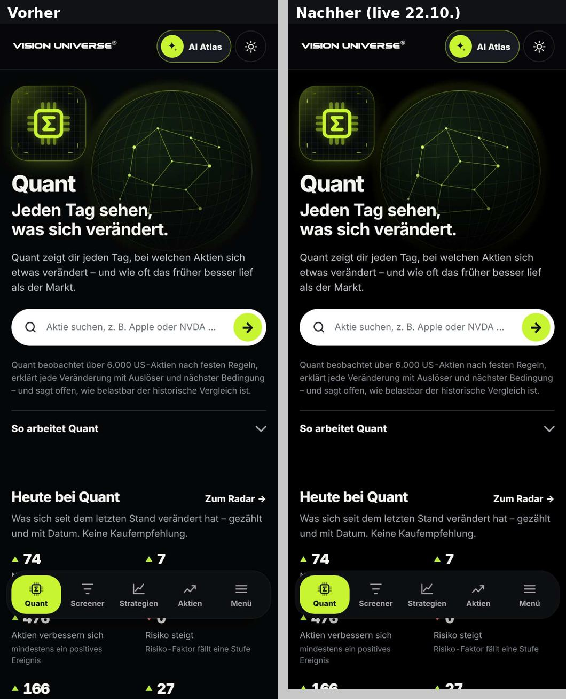
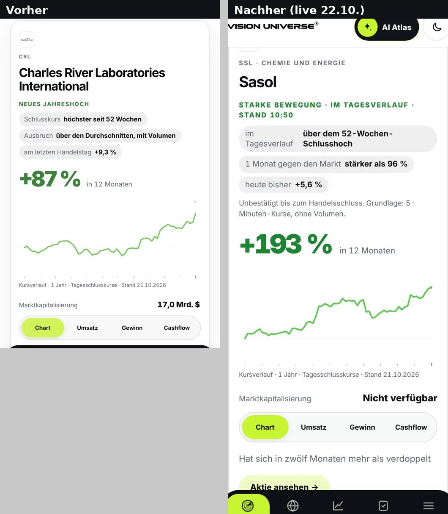
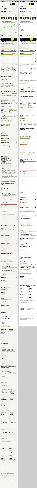
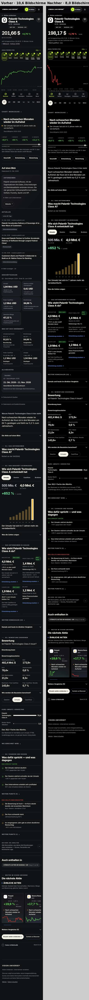

# VU3-Finalisierung – UI/UX und Quant-Verständlichkeit (22.10.2026)

Auftrag: Master-Prompt „UI-/UX-Finalisierung und Quant-Verständlichkeit“ vom 22.10.2026 mit vier iPhone-Screenshots (Quant-Skalen, Quant-Rückblick, Quant-Start, Discover-Karte Charles River).
Grundlage: [Visuelle Bestandsaufnahme](VU3_VISUELLE_BESTANDSAUFNAHME_2026-10-21.md), [UI-Refresh-Abschluss](VU3_UI_REFRESH_ABSCHLUSS_2026-10-21.md), [VU3 UI-System](../design/VU3_UI_SYSTEM.md).
Bilder: [`vu3-finalisierung-2026-10-22/`](vu3-finalisierung-2026-10-22/).

## Ergebnis (live geprüft, Release `248e764` und `52303d9`)

- **Karte:** Discover-Aktienkarte ist vollständig klickbar; Umschalter (Chart/Umsatz/Gewinn/Cashflow) behalten ihre Funktion. Live 18/18 Klickziele auf iPhone und Desktop korrekt.
- **Hintergründe:** alle Welten hell `rgb(255,255,255)`, dunkel `rgb(0,0,0)` – auch die Heros.
- **Quant:** Ergebnis zuerst, Alltagssprache, Technik im Aufklapper; Erwartungstrend (0 von 6.435 Aktien messbar) nicht mehr in der Übersicht, Grund beim Faktor.
- **Länge:** Quant PLTR iPhone 12,5 → 8,4 Bildschirme, Discover PLTR 10,6 → 8,0.
- **Gesondert offen:** E1, E2 (Faktor-Abdeckung), K1, K2 (Kurs im Kopf), C1 (`vu-chart`-Umstellung) – siehe unten.

| Vorher → Nachher | |
|---|---|
| Quant-Skalen |  |
| Quant-Rückblick |  |
| Quant-Start hell |  |
| Quant-Start dunkel |  |
| Discover-Karte |  |
| Quant PLTR ganz |  |
| Discover PLTR ganz |  |

## Pull Requests

| PR | Inhalt | Gate |
|---|---|---|
| #845 | Hintergründe hell `#FFFFFF`, dunkel `#000000` über die gemeinsamen Tokens; neutrale Grautöne statt Creme; helles Start-Schema in allen Welten | Shell, VU3-Regression, Vorsorge |
| #846 | Supertrader: dieselben Hintergründe und das helle Start-Schema im Erzeuger | Supertrader Gate A |
| #847 | Discover: ganze Aktienkarte als Einstieg (gemeinsame Karteninteraktion), Discover-Hintergründe, Chartfarben aus den gemeinsamen Tokens | Discover „keine Engine“, Frontend-Budget |
| #848 | Company Intelligence „Auf einen Blick“: keine Kästen, zwei Meldungen sichtbar | Company Intelligence `validate` |
| #852 | Betrieb: täglicher Vorsorge-Neubau scheiterte an zwei neuen ETF-Seiten (BRCE, BRIE) – `main` war seit dem Morgen rot | – |
| #853 | Quant: Skalen nur gemessen, Rückblick in Alltagssprache, kürzere Aktienseite, Tagesschluss im Technik/Elliott-Kopf, Achse „0“ | Quant CI, vu2-Browser-QA |
| #854 | Aktienkopf: ein Name je Aktie in allen Welten | Core |
| #855 | Fix zu #854: Name unter dem Kürzel nachschlagen (Live-QA-Befund) | Core |

Kein Gate wurde abgeschwächt. Zwei Prüfungen wurden an die neue Oberfläche angepasst, ohne ihre Aussage zu ändern: Die vu2-Browser-QA klappt den Rückblick auf, bevor sie Stufe C liest, und die Direktlink-Prüfung zählt zugeklappten Inhalt nicht als „leeren Abschnitt“ (beide #853).

## 1 · Ganze Aktienkarte (Discover)

- Eine gemeinsame Regel in `assets/site-navigation.js`: Eine Karte trägt ihr Ziel in `data-vu-href`. Ein Tipp oder Klick auf Logo, Name, Kennzahlen, Chart oder freie Fläche öffnet die Aktie.
- Eigene Bedienelemente bleiben eigenständig: Reiter Chart/Umsatz/Gewinn/Cashflow (`role=tab`), Links, Knöpfe.
- Keine verschachtelten Links: Die Karte ist kein `<a>`. Der Name ist der echte Link für Tastatur und Screenreader. Strg/Cmd/Mittelklick öffnen einen neuen Tab. Markierter Text öffnet nichts.
- Angewendet auf die Im-Blick-Karte (Charles River), die Kacheln mit Reitern und den Vollbild-Feed. Die übrigen Discover-Karten waren bereits vollständige Links.

## 2 · Weiß und Schwarz

- Die gemeinsamen Tokens in `assets/site-navigation.css`: `--vu-bg` hell `#fff`, dunkel `#000`. `--vu-surface` und die Linien sind neutral grau (`#f5f5f5`, `#e5e5e5`) statt Creme-Grün (`#f5f6f2`).
- Die Welt-Tokens folgen: Quant (`--q-bg`, Hero ohne Farbverlauf), Elliott/Technik, Fundamental, Hedgefonds, Vorsorge, Screener, Supertrader, Discover (`--v2-bg`, `--discover-bg`) und die Startseite.
- Produktbilder und Illustrationen (Globus, Icons) sind unverändert.
- **Theme:** Ohne gespeicherte Wahl starten alle Welten hell. Vorher starteten Quant, Elliott, Fundamental und Supertrader dunkel, die übrigen hell. Beim ersten Wechsel sprang das Schema deshalb um.

## 3 · Quant verständlich

Aufbau der Aktienseite nach der Frage, die ein Anleger stellt:

1. **Ergebnis:** „Mehr Stärken als Schwächen“ und darunter nur gemessene Eigenschaften als Skala 0–100.
2. **Einordnung:** Setup, Veränderungen, passender Anlagestil als drei Zahlen.
3. **Stärke der Aussage:** im Rückblick als eigene Zeile „Aussagekraft begrenzt“.
4. **Entwicklung:** „Was verändert sich gerade?“ mit Zählung besser/schlechter.
5. **Berechnung:** jeweils hinter einem Aufklapper.

Rückblick („Was geschah früher in ähnlichen Situationen?“), vorher Fachkacheln *Beobachtet · Getestet · Zertifiziert* und ein langer Absatz zu Point-in-Time-Stichtagen. Jetzt:

> **Diese Aktie früher** – In 12 ähnlichen Lagen stand der Kurs 6 Monate später in **83 %** der Fälle höher. Typisches Ergebnis: +47,3 %.
> **Im ganzen Markt** – Aktien mit demselben getesteten Signal lagen nach 6 Monaten **1,4 Prozentpunkte** häufiger im Plus als der Markt – kleiner Vorteil.
> **Aussagekraft begrenzt** – wenige Fälle dieser Aktie · marktweite Belege eingeschränkt · noch kein zertifizierter Backtest

Stufen A/B/C, Prüfbedingungen und Methodik stehen vollständig unter „Einzelheiten und Methodik“. Die Absage „keine Prognose“ bleibt sichtbar.

## 4 · Erwartungstrend und Vollständigkeit der Skalen

Gezählt über alle Shards von `quant/data/product/factor-evidence-v1` (Stand 21.10.2026, 6.435 Titel):

| Eigenschaft | bewertet | Anteil | häufigster Grund ohne Wert |
|---|---:|---:|---|
| Kursstärke | 5.625 | 87,4 % | zu wenige Komponenten (646) |
| Risiko | 5.625 | 87,4 % | Eingabe fehlt (782) |
| Bilanz- & Ergebnisqualität | 3.661 | 56,9 % | Eingabe nicht materialisiert (1.470) |
| Wachstum | 3.239 | 50,3 % | Eingabe nicht materialisiert (2.056) |
| Bewertung | 2.578 | 40,1 % | Eingabe nicht materialisiert (2.152) |
| Profitabilität | 1.947 | 30,3 % | Eingabe nicht materialisiert (2.380) |
| **Erwartungstrend** | **0** | **0,0 %** | `BLOCKED_EXTERNAL` (6.435) |

Gemessene Eigenschaften je Titel:

| gemessen | 0 | 1 | 2 | 3 | 4 | 5 | 6 |
|---|---:|---:|---:|---:|---:|---:|---:|
| Titel | 773 | 8 | 1.648 | 553 | 867 | 1.272 | 1.314 |

Antworten auf die Fragen des Auftrags:

1. **Verfügbar:** bei keiner Aktie.
2. **Abdeckung:** 0 von 6.435 Titeln.
3. **Was fehlt:** eine lizenzierte, zeitpunktgenaue Historie von Analystenschätzungen (Konsens je Stichtag). Der Faktor misst die Veränderung dieser Schätzungen.
4. **Technisch:** Vertrag, Gewicht (15 %), Methodik und Anzeige sind angelegt. Die Engine liefert bewusst `BLOCKED_EXTERNAL`, und ein Gesamtscore wird deshalb nicht gebildet.
5. **Vorhandene Daten:** `dashboard/data/analyst_ratings.json` (Finnhub/FMP) deckt 11 Titel ab, nur Empfehlungsstufen der letzten Monate, keine Schätzungshistorie. Das ist nicht tragfähig.
6. **Sinnvoll in dieser Form:** nicht als sichtbare Skala ohne Wert. Der Faktor bleibt im Methodenvertrag, bis es eine Quelle gibt.

**Entscheidung (geringe Abdeckung):**
- Der Erwartungstrend steht nicht mehr in der Übersicht. Darunter steht „Nicht bewertbar: Erwartungstrend – warum, steht bei der Eigenschaft“, mit einem Sprung zum Grund.
- Dieselbe Regel gilt je Aktie für jede andere nicht messbare Eigenschaft.
- Der Satz „3 von 6 gemessenen Eigenschaften stark …“ nennt den echten Nenner.
- Im Faktor-Kapitel bleiben alle sieben Eigenschaften mit Grund. Nichts wird geschätzt oder als Null gezeigt.

**Gesondert offen (Modell/Daten, nicht in diesem Auftrag):**
- **E1 Erwartungstrend:** Eine Datenquelle für Schätzungsrevisionen mit Point-in-Time-Historie wäre nötig, also ein neuer Anbieter mit Kosten. Danach braucht es einen eigenen Modell-PR mit Vorher/Nachher-Vergleich.
- **E2 Profitabilität (30 %) und Bewertung (40 %):** Die größte Lücke ist `INPUT_NOT_MATERIALIZED`. Die Eingaben (z. B. TTM-Margen, Börsenwert je Notierung) fehlen im Faktorbau, obwohl die SEC-Zahlen für rund 5.000 Titel vorliegen (Fundamental: 5.066). Das ist eine lösbare Materialisierungslücke im Faktorbau (`scripts/quant/build-factor-evidence.mjs` und die Eingabeschicht). Sie ist ein eigener, fachlich zu prüfender Quant-PR. Erwartung: deutlich höhere Abdeckung ohne Ersatzwerte.

## 5 · Kürzere Seiten

Gemessen live, Seitenhöhe ÷ Bildschirmhöhe (iPhone 390×844, Desktop 1440×900):

| Seite | iPhone vorher | iPhone nachher | Desktop vorher | Desktop nachher |
|---|---|---|---|---|
| Quant PLTR | 12,5 | **8,4** | 8,9 | **6,1** |
| Discover PLTR | 10,6 | **8,0** | 9,0 | **7,0** |
| Quant NVDA | – | 8,6 | – | – |
| Discover NVDA | – | 7,5 | – | – |
| Quant AAPL | – | 8,3 | – | – |
| Discover AAPL | – | 7,8 | – | – |
| Elliott Profi PLTR | 10,4 | 10,4 (nicht Teil des Auftrags) | – | – |

Quant liegt bei Aktien mit vielen Ereignissen knapp über 8 Bildschirmen; weiteres Kürzen ginge nur über gestrichene Inhalte oder kleinere Schrift und unterbleibt.

Gekürzt wurde ohne Inhaltsverlust, also ohne kleinere Schrift und ohne gestrichene Werte:
- **Quant:** Setup-Details, gesperrte Lebenszyklus-Stufen, Veränderungs-Details und weitere Anlagestile stehen je in einem Aufklapper. Das Unternehmenskapitel ist zugeklappt (vollständig in Discover). Je Seite ist der stärkste Pro/Contra-Punkt sichtbar. Die Fußzeile ist ein Absatz.
- **Discover und Quant:** Das Kapitel „Auf einen Blick“ hat keine Kästen mehr und zeigt zwei statt drei Meldungen.

## 6 · Kurs im Aktienkopf

Gemessen live am 22.10., 11:00 MESZ, PLTR:

| Welt | Kopf vorher | Art |
|---|---|---|
| Quant, Fundamental, Supertrader | 201,72 $ · Schlusskurs 21.10. | veröffentlichter Tagesschluss |
| Technik, Elliott | 186,03 $ · Wochenschluss 16.10. | letzter Wochenschluss des Aktienbilds |
| Discover (Chartkopf) | 201,66 $ · „am 21.10.2026“ | letzter 5-Minuten-Kurs der Sitzung |
| Hedgefonds | kein Kurs | – |

**Regel für den gemeinsamen Kopf:**
1. **Während der Handelszeit:** der laufende Kurs mit „Live“ oder „Verzögert“ und Uhrzeit.
2. **Nach Handelsschluss:** der veröffentlichte Tagesschlusskurs mit „Schlusskurs · Datum“. Er ersetzt den letzten Intraday-Kurs desselben Tages, sobald er vorliegt.
3. **Analysekurse** (Wochenschluss im Aktienbild, Stichtag des Rückblicks, Kurs eines Backtests) stehen nicht im Kopf, sondern bei ihrer Analyse, mit Datum.

**Umgesetzt (#853):** Technik und Elliott zeigen im Kopf den Tagesschluss aus derselben Quelle wie Quant. Der Wochenschluss bleibt im Aktienbild.

**Gesondert offen (Datenlogik):**
- **K1 Discover:** Nach Sitzungsende zeigt der Discover-Chartkopf den letzten 5-Minuten-Kurs (201,66 $) statt des amtlichen Schlusskurses (201,72 $, Schlussauktion). Das entscheidet `quant/engines/realtime/source-state.js` (Zustand `FINAL_SESSION`). Diese Datei liegt außerhalb der Discover-Welt, und die Regel gilt dort für alle Intraday-Ansichten. Nötige Anpassung: Ist der veröffentlichte Tagesschluss für `sessionDate` da, steht er mit „Schlusskurs“ im Kopf, und die Intraday-Linie bleibt der Verlauf. Dazu gehört ein eigener PR mit Tests der vier Quellzustände.
- **K2 Hedgefonds:** Der Kopf zeigt keinen Kurs. Den Tagesschluss aus dem Discover-Artefakt zu lesen, wäre eine neue Datenabhängigkeit der Hedgefonds-Welt (Isolations-Gate). Das bleibt ein eigener Schritt.

## 7 · Charts

- Discover-Chartfarben kommen jetzt aus den gemeinsamen Tokens `--vu-chart-up` und `--vu-chart-down`. Farbe und Linie sind damit eine Quelle.
- **Prüfung der Umstellung `discover/ui/microchart.js` → `assets/vu-chart.js`:** Ohne Funktionsverlust ist sie noch nicht möglich, weil `vu-chart` Folgendes nicht kann:
  1. Kursabschnitte mit Datenlücken (`segments`, europäische Reihen, eigener Test `europe-chart-segments`)
  2. einzelne geprüfte Beobachtungspunkte
  3. Sitzungs-Intraday mit Vortagesschluss (`renderIntraday`)
  4. Sparklines der Karten mit Renditeleiter (§12 Chart Truth Contract)
  5. die per Hash festgeschriebene US-Ausgabe
- **Weg (gesondert offen, C1):**
  1. `vu-chart` um `segments`, Beobachtungspunkte und einen Intraday-Modus erweitern.
  2. Discover-Detailchart umstellen, mit neuem Referenz-Hash im Vorher/Nachher-Vergleich.
  3. Danach die Karten-Sparklines.
  Das sind zwei eigene PRs wegen des Discover-Gates und der Europa-Abhängigkeit (OFFEN 2).

## 8 · Weitere Unstimmigkeiten

| Punkt | Stand |
|---|---|
| Unternehmensname im Kopf | ein Name aus dem Security-Master (`displayName`) in allen Welten (#854) |
| Unbeabsichtigter Theme-Wechsel | alle Welten starten hell (#845, #846) |
| „−0,00“ an der Technik-Achse | „0“ (#853, `quant/ui/ti-chart.js`) |
| Verschachtelte Kästen | „Auf einen Blick“ ohne Kästen (#848), Kursstruktur-Karte ohne Rahmen (#853) |
| Wiederholte Quellen | Quant-Fußzeile ohne zweite Quellenzeile, Quellen in „Daten & Methodik“; „Was ist jetzt wichtig?“ wiederholt die Setup-Stufe nur bei neuen Ereignissen |
| Kritische Warnungen | unverändert sichtbar (veraltete Daten, Zurückhaltung, Aussagekraft) |

## 9 · Live-QA

| Prüfung | Ergebnis |
|---|---|
| Hintergründe aller Welten hell/dunkel | `#FFFFFF` / `#000000` |
| Kartenklick Discover iPhone + Desktop | 18/18 |
| Aktienkopf PLTR Quant/Technik/Elliott/Fundamental | 201,72 $ · Schlusskurs 21.10. |
| Aktienkopf PLTR Supertrader während der Sitzung | 198,12 $ · Verzögert 11:30 ET – Quant bleibt in der Sitzung beim Tagesschluss (gehört zu K1) |
| Anzeigename je Welt (nach #855, 22.10. 18:15 MESZ) | PLTR „Palantir Technologies Class A“, NVDA „NVIDIA“ – gleich in allen sieben Welten (vorher drei Varianten) |
| Kontrast/Überlauf (VU3-Regression) | 148 Prüfungen, 0 Befunde |
