# VU3 UI-/UX-Refresh – Abschlussbericht

Stand: 21.10.2026, abends. Geprüft wurde die ausgelieferte Seite `research.visionuniverse.de`. Die Anmeldung lief über das echte Login-Formular, auf Desktop (1440 px) und iPhone 14 (Chromium).

Ausgangslage: [Visuelle Bestandsaufnahme](VU3_VISUELLE_BESTANDSAUFNAHME_2026-10-21.md). Regeln: [VU3 UI-System](../design/VU3_UI_SYSTEM.md).

## Ergebnis

- **Alle neun Welten sind geändert und live:** Discover, Quant, Technik/Elliott, Supertrader, Fundamental, Hedgefonds, Vorsorge, Screener, Dashboard.
- **Einheitlicher Aktienkopf:** Jede Aktienseite beginnt mit demselben Kopf. Er zeigt Logo, Name und **einen** beschrifteten Kurs, etwa „Schlusskurs · 20.10.“, „Verzögert · 15:35 Uhr ET“ oder „Wochenschluss“. Direkt darunter steht der Navigator mit sieben Welten. Gilt für Discover, Quant, Technik, Elliott, Supertrader, Fundamental und Hedgefonds.
- **Navigator:**
  - In beide Richtungen auf allen sieben Aktienseiten.
  - In Discover direkt unter dem Kurs und vor dem Chart, nicht mehr etwa zwölf Bildschirme tief.
  - Hedgefonds ist neu die siebte Welt.
- **Ein Kurschart-System** (`assets/vu-chart.js`) nach dem Vorbild des Discover-Charts, in Quant, Supertrader und auf den ETF-Seiten von Vorsorge:
  - Linie grün/rot gegen den Startkurs, gestrichelte Startlinie, Punkt am letzten Kurs.
  - Achse rechts, Zeitraum-Leiste, kein Rahmen.
  - Fachliche Diagramme bleiben in ihrer Form: Wellenzählung und Chartbild in Elliott/Technik, Portfolio-Grafiken in Vorsorge, Umsatzbalken in Fundamental.
- **Weniger Kästen und Text:**
  - Ergebnis zuerst, Methodik hinter „Mehr“.
  - Quellen und Zeitstempel einmal je Seite in „Daten & Methodik“.
  - Warnungen zu veralteten Daten bleiben sichtbar.
- **Schema:** Hell und Dunkel sind WCAG-AA-fest. Geprüft wurden 25 Routen in beiden Schemata bei 390 und 1440 px (`vu3-regression`). Die zuerst besuchte Welt legt das Schema fest, ohne ungewollten Wechsel.
- **Keine Änderung an:** Navigation, Dock, Produktnamen, Icons, Farbwelt, Typografie, Berechnungen, Scores, Modellen und Datenlogik.

## Pull Requests

Alle PRs wurden per Squash gemergt, nachdem alle Pflichtprüfungen grün waren. Kein Gate und kein Test wurde abgeschwächt. Der rote `Vercel`-Status kam auf allen PRs vom Kontolimit des Gratis-Tarifs und wurde je PR kommentiert.

| PR | Inhalt | Merge |
|---|---|---|
| #828 | Fundament: UI-Bausteine, Navigator 2.0 mit Aktienkopf, `vu-chart.js`, Hedgefonds im Manifest, Schema | `844386e08` |
| #837 | Fundament 1b: Kursmarken, Fingerspur, kompakter Kopf, Kontrastfarben, Achsen ohne Überdruck | `052a4f304` |
| #829 | Discover | `bc3d67a3a` |
| #838 | Quant | `e836eeb03` |
| #831 | Technik/Elliott | `f79f4b33d` |
| #830 | Supertrader | `fb8bda46f` |
| #832 | Fundamental | `3add9f62f` |
| #833 | Hedgefonds | `07f5c74f5` |
| #834 | Vorsorge | `e16642aba` |
| #835 | Screener | `a4bbd47cd` |
| #836 | Dashboard | `9cd537bb0` |

Auslieferung: Lauf „Quant 2.0 Production Pages“ 39667491222 auf `88cc40c1d`. Dieser Stand enthält alle Merges. Der Deploy war erfolgreich.

## Abnahme: PLTR in Discover, Quant und Supertrader

**Vorher (iPhone):** Drei verschiedene Köpfe:
- Quant zeigt zwei Kurse untereinander (192,60 $ Schluss, 197,19 $ intraday).
- Supertrader hat keinen Navigator und führt den Kurs als Nebentext.

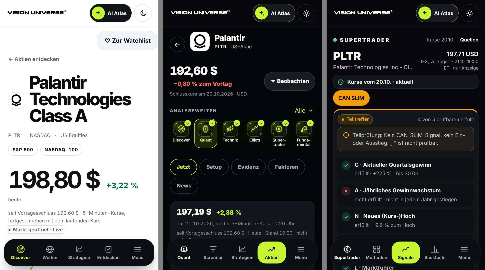

**Nachher (iPhone, hell und dunkel):** Gleicher Kopf, gleicher Navigator an gleicher Stelle, gleiche Chartsprache.

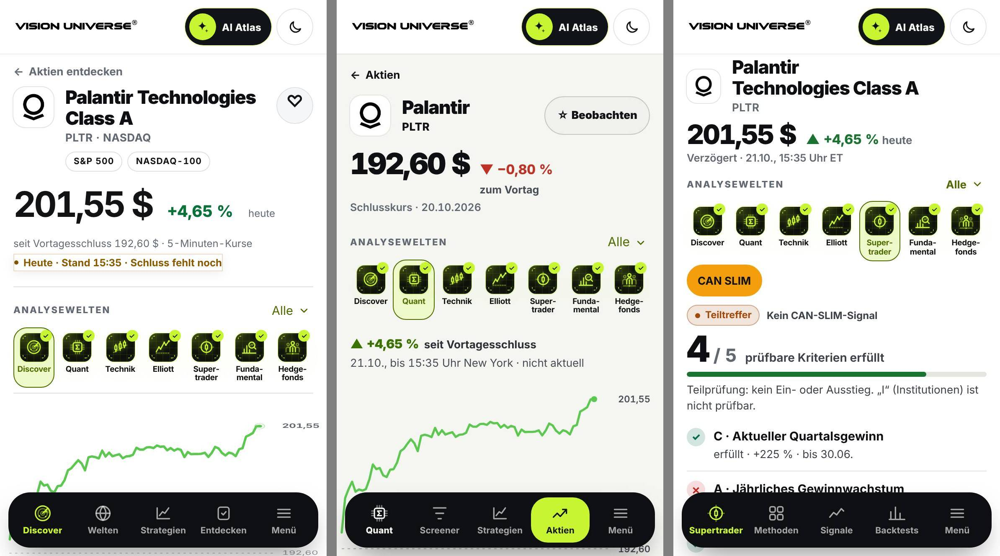

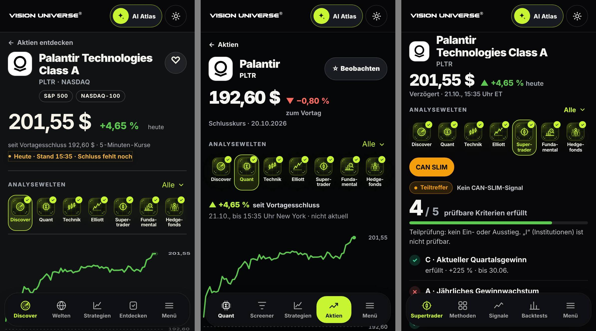

**Desktop vorher und nachher:**

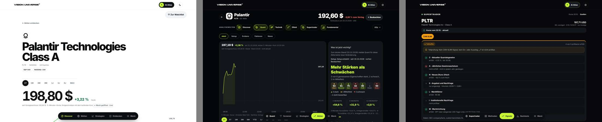

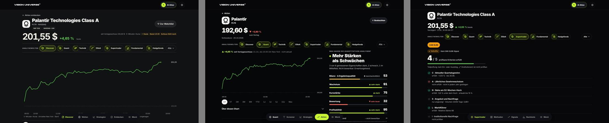

## Abnahme: Quant auf dem iPhone

**Oben, vorher und nachher:**
- Vorher: zwei Kurse, Reiter und ein Kasten im Kasten.
- Nachher: ein Kurs, Navigator, Kursänderung des Tages, dann der Chart.

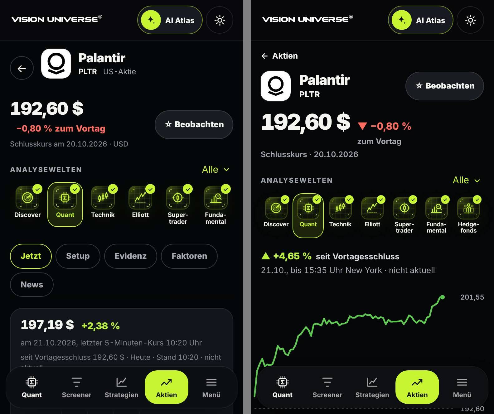

**Ganze Seite** in der Standardansicht ohne aufgeklappte Details, vorher links:

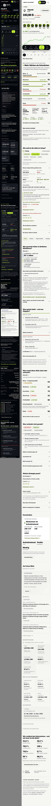

## Messwerte

Gemessen wurde die Standardansicht ohne aufgeklappte Details. „Bildschirme“ ist die Seitenhöhe geteilt durch die Fensterhöhe (iPhone 844 px, Desktop 900 px).

Die Nachher-Werte sind strenger erhoben: Die Seite wurde einmal durchgescrollt, sodass nachgeladene Inhalte mitzählen. Kontrolle ist die unveränderte Startseite `/`: Ihre Höhe stimmt überein, ihre Wortzahl steigt durch diese Messart von 437 auf rund 2.450. Für die Aktienseiten ist die Höhe deshalb der belastbare Vergleich.

| Seite | iPhone vorher | iPhone nachher | Desktop vorher | Desktop nachher |
|---|---:|---:|---:|---:|
| Discover PLTR | 18,0 | **10,4** | 15,2 | **9,0** |
| Quant PLTR | 17,7 | **12,5** | 12,0 | **8,9** |
| Elliott PLTR (Profi) | 12,1 | **10,4** | 7,5 | **6,5** |
| Hedgefonds PLTR | 9,1 | **3,3** | 7,7 | **2,5** |
| Fundamental PLTR | 9,9 | **7,5** | 4,9 | 4,9 |
| Technik PLTR | 5,6 | **4,5** | 4,4 | **3,8** |
| Supertrader PLTR | 2,1 | 2,5 | 1,9 | 2,4 |
| Hedgefonds Start | 10,6 | **5,2** | 5,2 | **3,9** |
| Elliott Start | 3,9 | 5,9 | 3,4 | 3,7 |
| Quant Start | 7,8 | **6,1** | 4,8 | **3,8** |

Supertrader PLTR ist etwas länger, weil jetzt Kopf, Navigator und Kurschart vor dem Regelcheck stehen. Elliott Start ist länger, weil die Ranglisten nun sofort und vollständig erscheinen statt als leere Platzhalter.

Weitere Unterseiten, mit dem Erfassungsskript der Bestandsaufnahme gemessen (nach Klick-Aktionen, iPhone):

| Seite | vorher | nachher |
|---|---:|---:|
| Hedgefonds Investoren | 28,8 | 5,0 |
| Elliott Welle 3 | 11,3 | 4,1 |
| Elliott Neu | 12,0 | 4,6 |
| Vorsorge ETFs | 11,9 | 4,4 |
| Supertrader Methoden | 11,4 | 4,1 |
| Supertrader Backtests | 6,4 | 3,7 |
| Vorsorge Wissen | 4,3 | 1,8 |

Auf keiner der 51 erfassten Routen gab es horizontales Scrollen oder einen Skriptfehler.

## Welten im Einzelnen (iPhone, vorher links)

**Discover:**

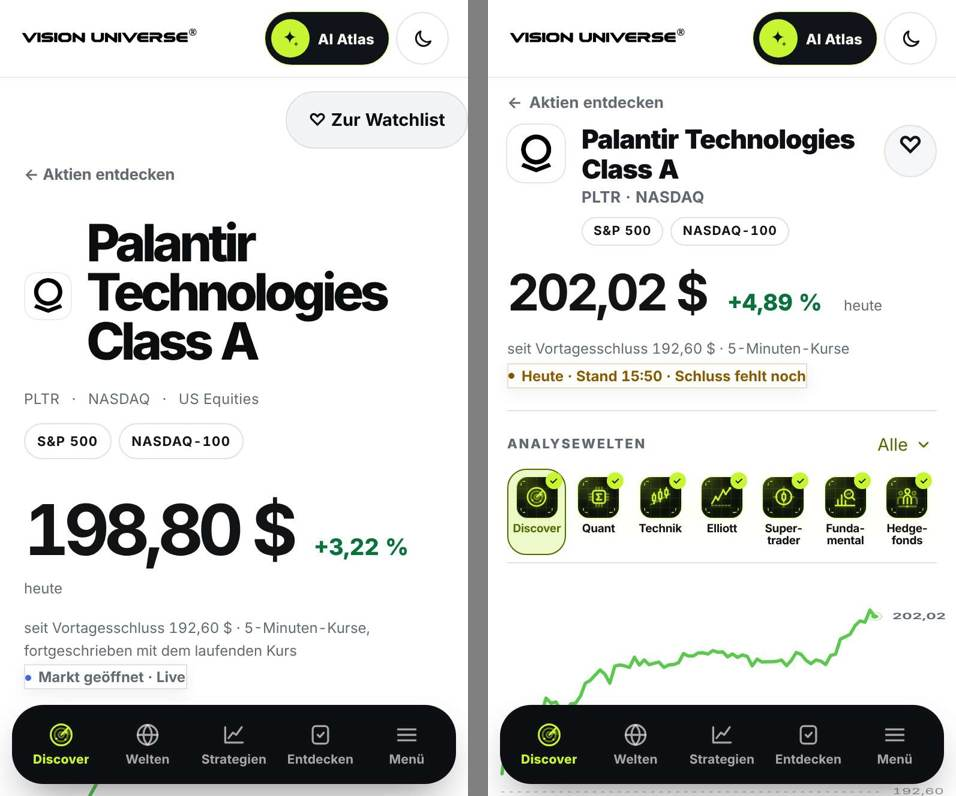

**Technik und Elliott:**

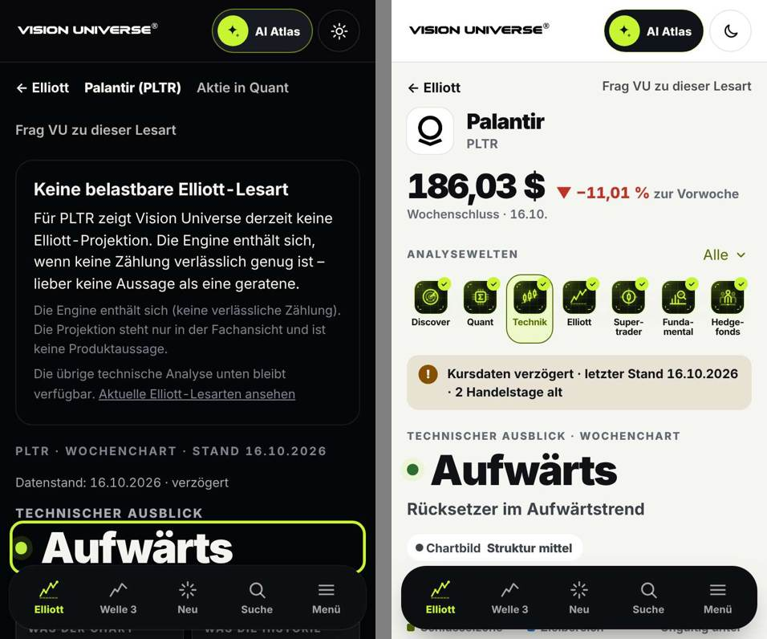

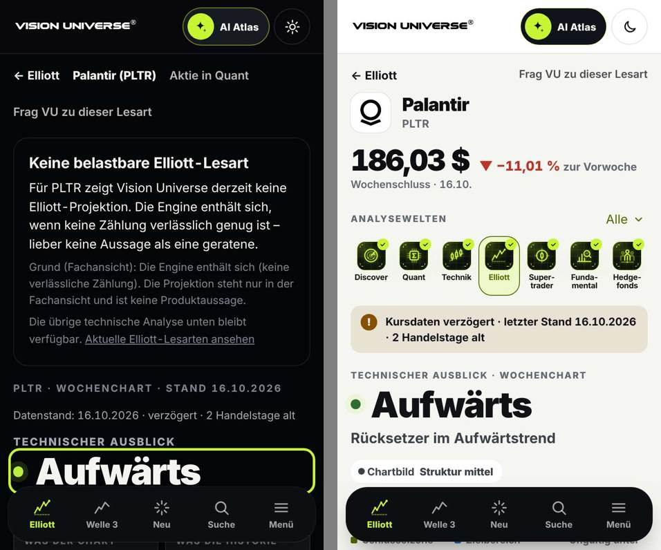

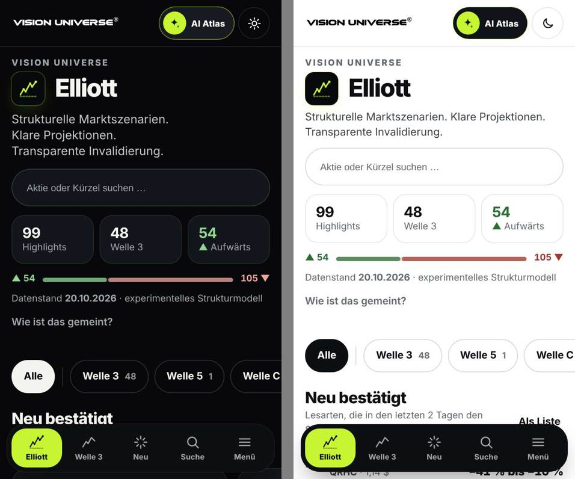

**Supertrader:**

**Fundamental:**

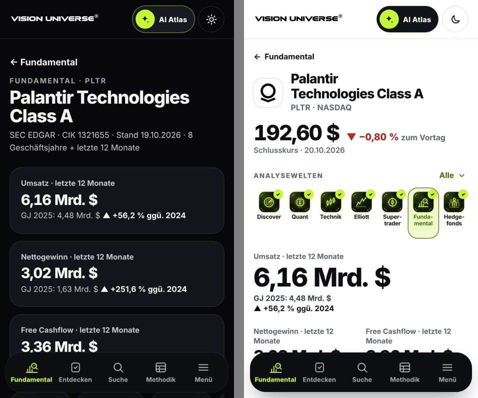

„Entdecken“ zeigte vorher unter `#/entdecken` nur die Startseite mit vier Einträgen. Jetzt steht dort die eigentliche Rangliste mit rund 30 Unternehmen. Die Seite ist dadurch länger, aber nicht textlastiger.

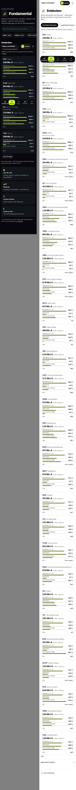

**Hedgefonds:** Ganze Startseite. Der Hero bleibt, darunter Ranglisten statt Fließtext.

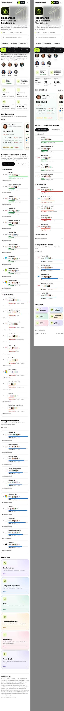

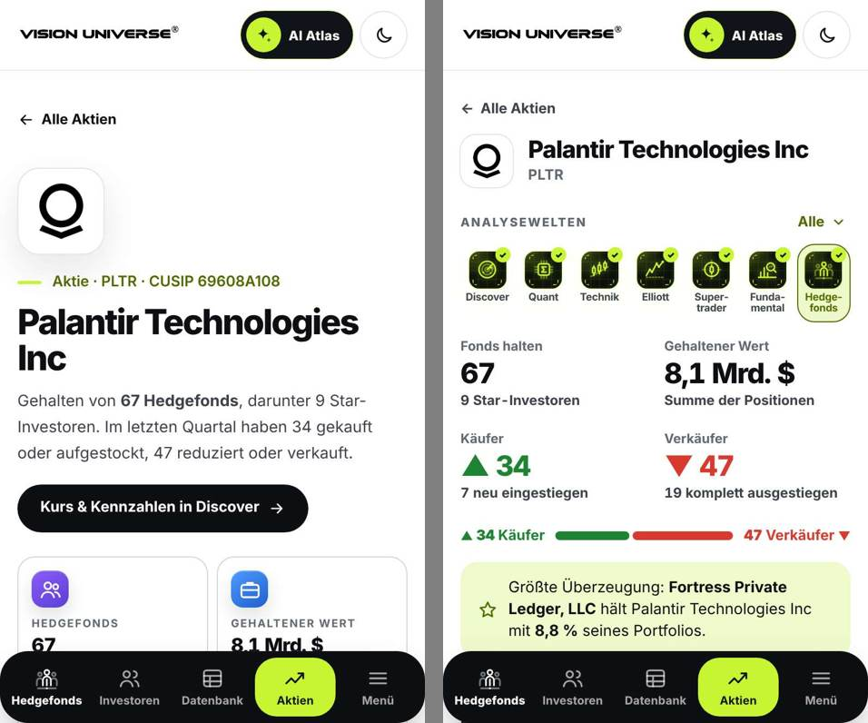

**Vorsorge:** ETF-Liste und Kennzahl statt Erklärtext vor der Liste.

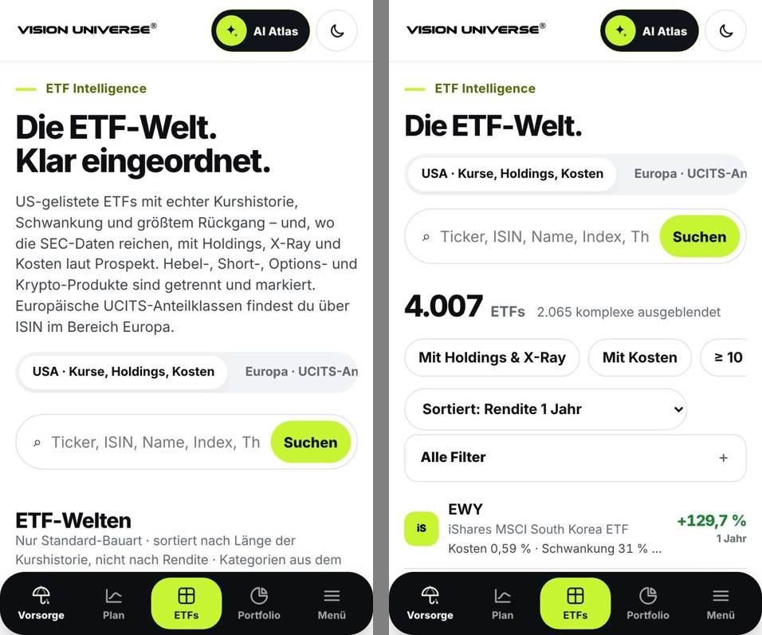

**Screener und Dashboard:**

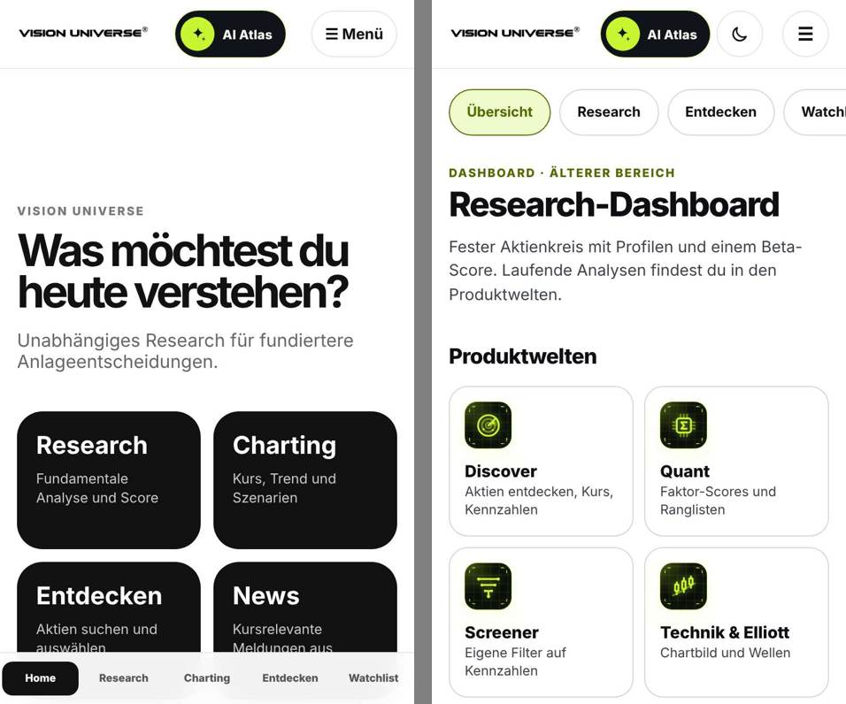

## Offene Punkte

Diese Punkte sind nicht erledigt. Bei einigen hätte eine Änderung die Grenzen des Auftrags berührt.

1. **Seitenlänge Quant PLTR:**
   - Quant liegt mit 12,5 iPhone-Bildschirmen weiter über dem Ziel von unter 8 aus der Bestandsaufnahme.
   - Discover und Elliott Profi liegen bei 10,4.
   - Der Rest sind fachliche Abschnitte (Eigenschaften, Setup, Belege, Fälle). Sie weiter zu kürzen hieße, Inhalte der Modelle wegzunehmen. Das bleibt ein eigener Schritt.
2. **Kurs nach Handelsschluss in drei Welten verschieden:**
   - Nach dem letzten Intraday-Kurs (heute 15:35 ET) und vor dem neuen Tagesschluss zeigen Discover und Supertrader „201,55 $ · Verzögert“. Quant zeigt „192,60 $ · Schlusskurs 20.10.“.
   - Grund: Der Quant-Chart erklärt Intraday-Kurse, die nicht mehr frisch sind, als „nicht aktuell“ und nimmt dann den veröffentlichten Schluss.
   - Jeder Kopf ist eindeutig beschriftet. Gleiche Zahlen über alle Welten brauchen aber eine gemeinsame Frischeregel, und das ist Datenlogik, also ein eigener PR.
   - Elliott zeigt bewusst den „Wochenschluss“.
3. **Name im Kopf:** Discover, Supertrader und Fundamental zeigen „Palantir Technologies Class A“, Quant und Elliott „Palantir“, Hedgefonds „Palantir Technologies Inc“. Jede Welt übernimmt den Namen aus ihren eigenen Daten. Einheitlich wird er erst mit einer gemeinsamen Namensquelle über `core/identity`.
4. **Zwei Chart-Umsetzungen:** Discover nutzt weiter seinen eigenen Chart (`discover/ui/microchart.js`), der als Vorbild diente. Quant, Supertrader und Vorsorge (ETF-Seiten) nutzen `vu-chart.js`. Das Bild ist gleich, der Code ist es nicht.
5. **„−0,00“ an der Achse:** Der gemeinsame Technik-Chart (`quant/ui/ti-chart.js`) zeigt diese Achsenbeschriftung weiterhin. Das Modul wurde nicht angefasst.
6. **Dashboard ohne Dock:** Ein Dock wäre eine Änderung der Navigation und ist ausgeschlossen. Tote Links gibt es keine.
7. **Unverändert:**
   - Die Startseite `/` (15 Desktop- bzw. 27 iPhone-Bildschirme) war nicht Teil der Welten-Liste.
   - Die Discover-Startseite unterhalb des Hero ist ebenfalls unverändert.
8. **Vercel:** Der Status bleibt rot, solange das Kontolimit greift. Das ist kein Code-Fehler.
