# Vision Universe 3.0 – Visuelle Bestandsaufnahme (21.10.2026)

Live-Seite `research.visionuniverse.de`. Keine Frontend-Änderung, kein Redesign. Nur Aufnahme, Befund und Priorität.
Bilder: [`vu3-visuelle-bestandsaufnahme-2026-10-21/`](vu3-visuelle-bestandsaufnahme-2026-10-21/).

## Kurzfazit

1. **Die Welten sind einzeln weit, aber nicht verbunden.** Nur die Quant-Aktienseite hat den Aktien-Navigator „Analysewelten“. Alle anderen Aktienseiten sind fast Sackgassen: Sie haben höchstens einen Link in eine andere Welt, und den gibt es nur in eine Richtung.
2. **Das Dashboard ist eine Altwelt.** Es hat eine eigene Navigation, kein Dock, einen eigenen „Vision Universe Score“ und eine leere Charting-Seite („Daten nicht verfügbar“). Es widerspricht dem 3.0-Grundsatz „kein Score“ in Fundamental.
3. **Technik ist keine eigene Welt.** Technik hat keinen Menüeintrag, keine Startseite und kein Dock. Die Übersicht läuft unter dem Quant-Dock, die Aktienseite unter dem Elliott-Dock.
4. **Dieselbe Aktie sieht in jeder Welt anders aus.** Name, Überschrift, Preis, Zeitstand und Farbschema wechseln von Welt zu Welt.
5. **Die Aktienseiten sind zu lang.** Discover und Quant brauchen auf dem iPhone je etwa 18 Bildschirmhöhen bei rund 2.200 Wörtern.

## Vorgehen

| Punkt | Umsetzung |
|---|---|
| Zugang | Anmeldung nur über das echte Login-Formular (`#research-password`), Passwort aus `RESEARCH_ACCESS_PASSWORD`. Wert nie ausgegeben, geloggt oder fotografiert. `/__research/content/` nicht aufgerufen |
| Browser | Lokales Chromium (Playwright 1.56). Desktop 1440 × 900. iPhone 14 (390 × 844, Touch, DPR 2) |
| Umfang | 56 Routen in 10 Welten plus Startseite `/`: Startseiten, alle Dock- und Menü-Unterseiten, 7 PLTR-Ansichten, globales Menü (Dock „Menü“), Dock, aufgeklappte Details (`
`, „Mehr lesen“, „Alle“). 261 Screenshots, davon 88 hier abgelegt |
| Nutzerwege | 4 Wege mit echten Klicks und Eingaben (siehe Abschnitt „Erste fünf Minuten“) |
| Zeitpunkt | 21.10.2026, US-Markt offen. Preise bewegen sich zwischen den Aufnahmen |
| Technik | Keine Konsolenfehler, kein horizontaler Überlauf auf allen 56 Routen (beide Geräte) |

Einmal beobachtet und nicht reproduzierbar: Die Technik-Übersicht `/quant/#/chartlagen` zeigte auf dem Desktop „Gerade nicht erreichbar – Die Daten konnten nicht geladen werden“. Beim nächsten Laden war sie in Ordnung.

## Pilot: Discover, Quant, Supertrader

| | Desktop | iPhone |
|---|---|---|
| Discover Start | 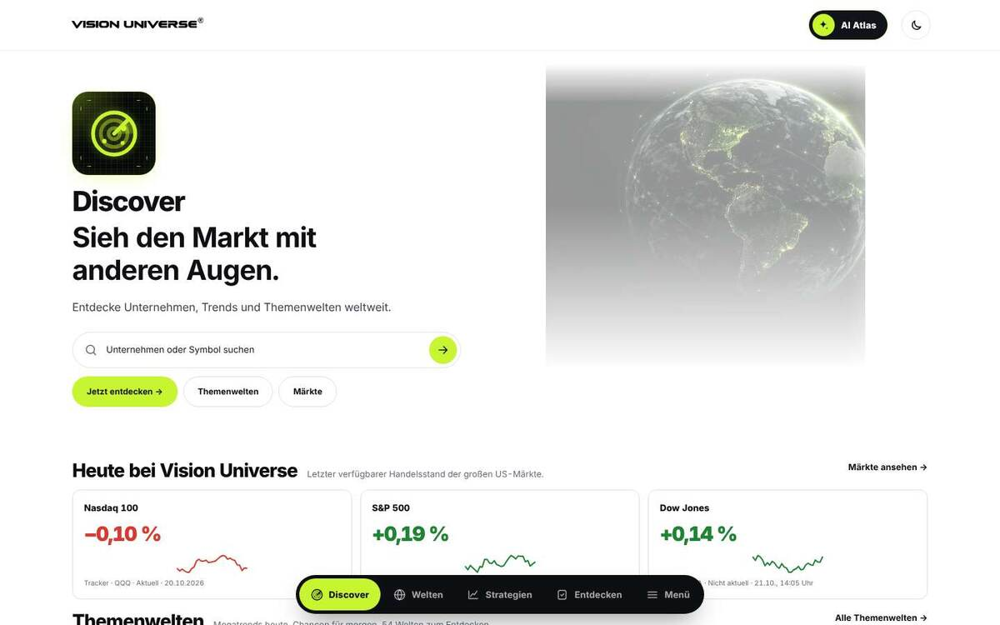 | 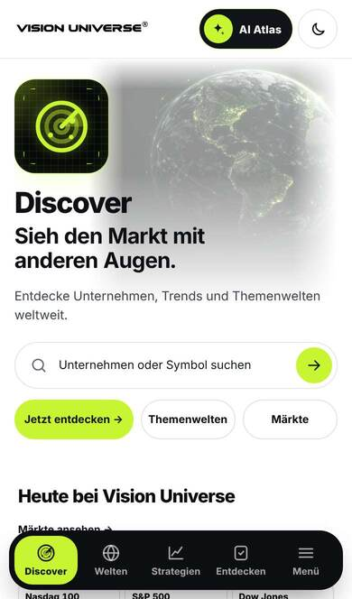 |
| Quant Start | 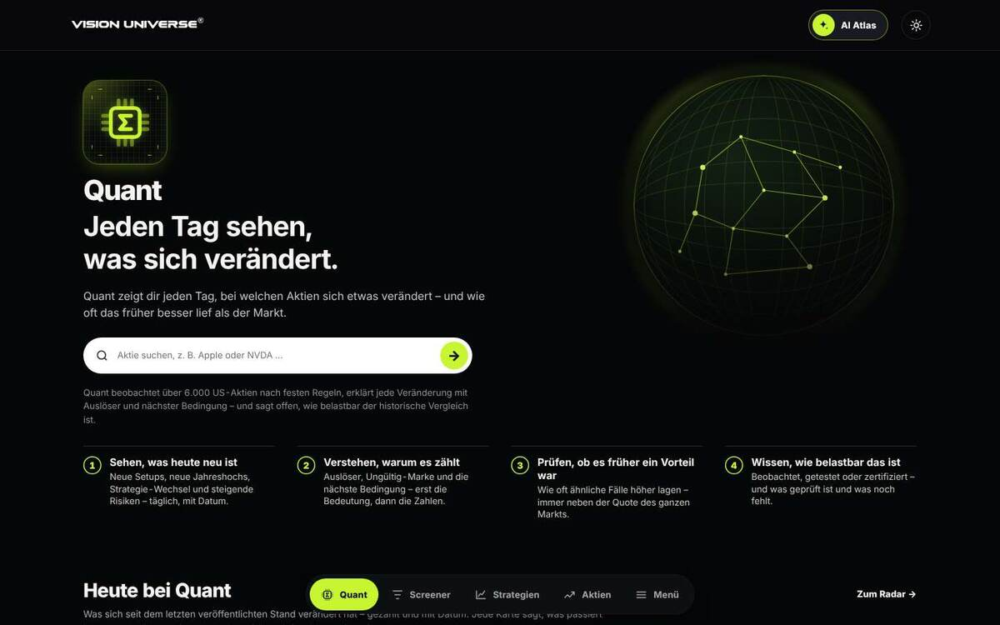 |  |
| Supertrader Start | 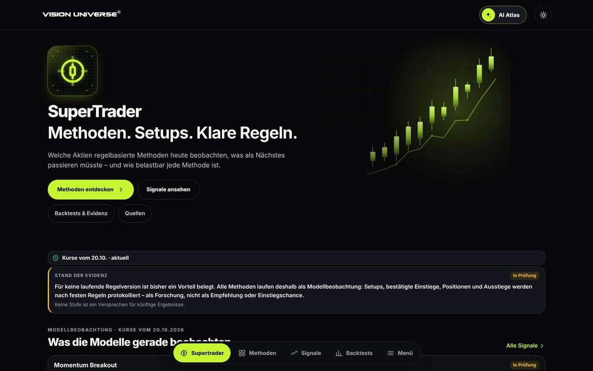 | 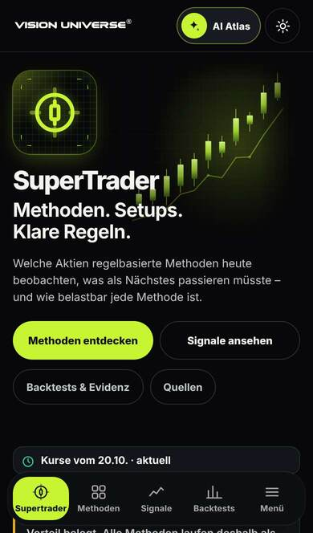 |
| Discover PLTR | 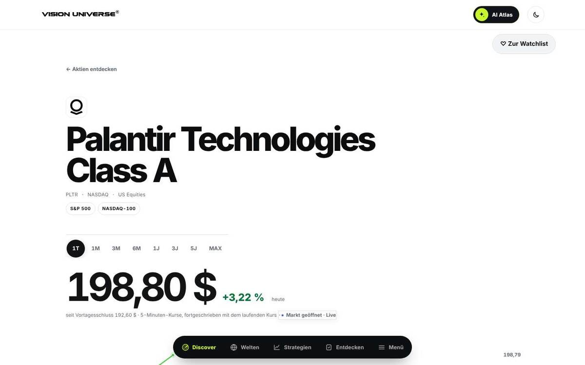 | 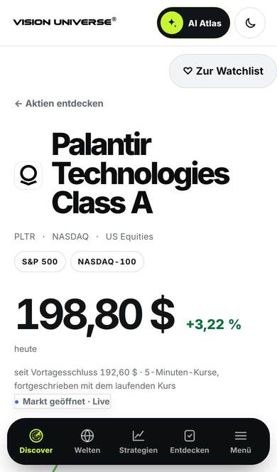 |
| Quant PLTR | 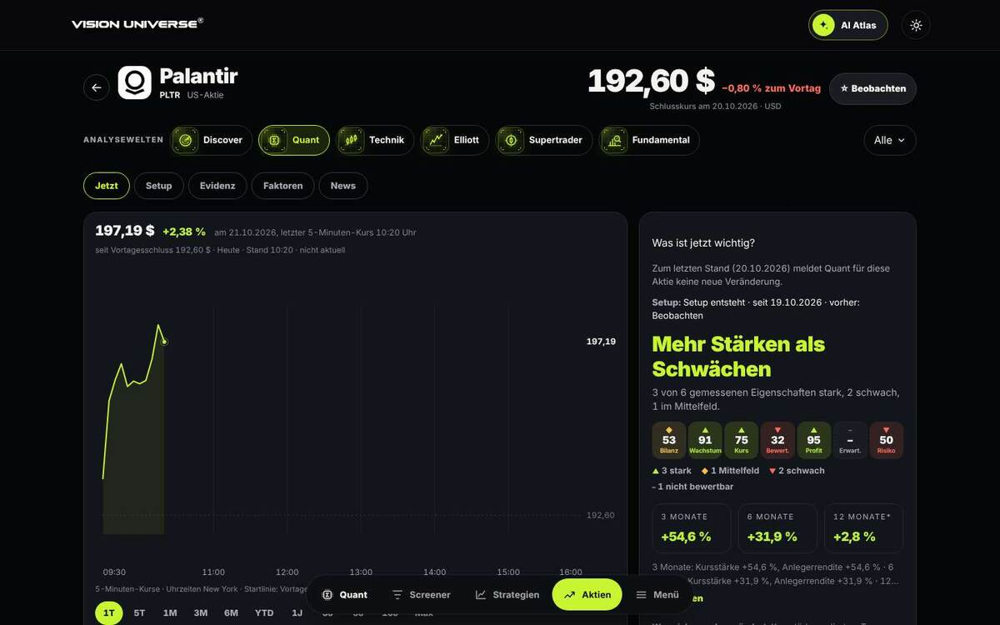 | 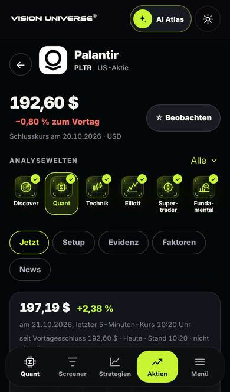 |
| Supertrader PLTR | 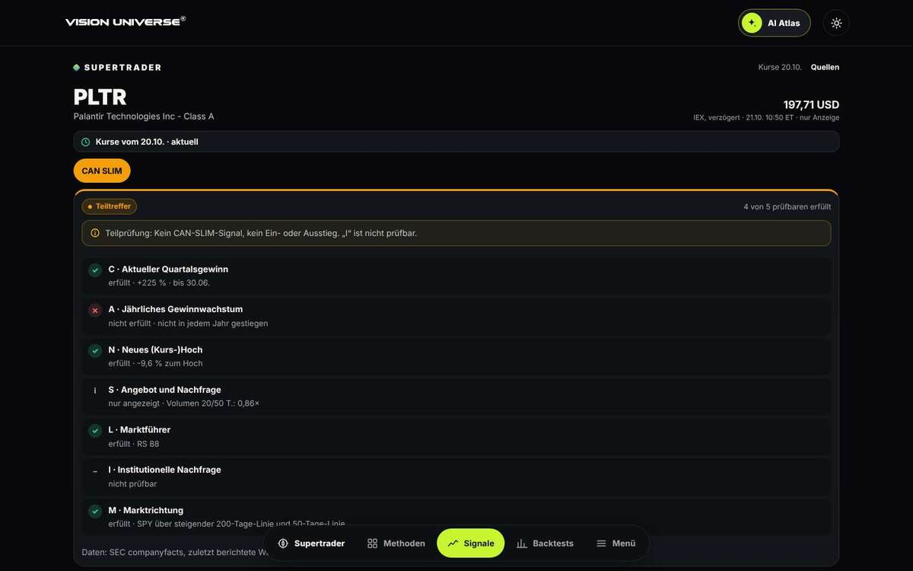 |  |

Der Pilot zeigt die Muster, die sich später in allen Welten wiederholen:
- Discover startet hell.
- Quant und Supertrader starten dunkel.
- Nur Quant verlinkt in die anderen Welten.

## Befund „Analysewelten“: im Browser bestätigt, mit einer Präzisierung

Der Code-Befund stimmt im Kern. `assets/stock-navigator.js` wird nur in `quant/index.html` und `quant/app/page-stock.js` eingebunden. Im Browser hat keine andere Aktienseite einen Navigator.

Die Präzisierung: Drei der Welten haben nicht „keine“ Links, sondern **genau einen**, und der führt nur in eine Richtung.

Sichtbare Links auf der PLTR-Seite, nach dem Aufklappen aller Details:

| Von ↓ / nach → | Discover | Quant | Technik | Elliott | Supertrader | Fundamental | Hedgefonds |
|---|---|---|---|---|---|---|---|
| **Discover** `/discover/#/s/US_REAL/PLTR` | – | ✗ | ◐ ein Link „Chartbild öffnen“, etwa 12 Bildschirme tief in einem Abschnitt (`discover/ui/detail.js:1793`) | ✗ | ✗ | ✗ | ✗ |
| **Quant** `/quant/#/aktie/PLTR` | ✅ | – | ✅ | ✅ | ✅ | ✅ | ✗ (nicht im Navigator) |
| **Technik** `/elliott/#/PLTR` | ✗ | ◐ Kopfzeile „Aktie in Quant“ (`quant/app/page-chartbild.js:491`) | – | ◐ Umschalter „Profi“ | ✗ | ✗ | ✗ |
| **Elliott** `/elliott/#/PLTR?ansicht=profi` | ✗ | ◐ „Aktie in Quant“ | ◐ Umschalter „Einfach“ | – | ✗ | ✗ | ✗ |
| **Supertrader** `/supertrader/stock/PLTR/` | ◐ „Vollständige Aktienansicht in **Discovery**“ am Seitenende (`supertrader/assets/supertrader.js:950`) | ✗ | ✗ | ✗ | – | ✗ | ✗ |
| **Fundamental** `/fundamental/#/PLTR` | ✅ | ✅ (zwei Links) | ◐ Link heißt „Elliott“, führt aber zu Technik `/elliott/#/PLTR` | ✗ | ✗ | – | ✗ |
| **Hedgefonds** `/hedgefonds/#/aktie/PLTR` | ✅ „Kurs & Kennzahlen in Discover“ | ✗ | ✗ | ✗ | ✗ | ✗ | – |

Weitere Punkte:
- **Fundamental** baut seine Linkliste selbst (`fundamental/app.js:567–575`). Sie hat vier Einträge. Supertrader und Hedgefonds fehlen, und der Eintrag „Elliott“ ist falsch beschriftet.
- **Hedgefonds** hat einen einzigen Link (`hedgefonds/app.js:1110`). Die Adresse wechselt nach dem Laden auf die CUSIP: `/hedgefonds/#/aktie/69608A108`.
- **Der Navigator selbst** kennt Hedgefonds nicht (`MODULES` in `assets/stock-navigator.js`), obwohl die Hedgefonds-Welt für PLTR eine eigene Seite hat.
- **Folge:** Wer über Quant → Analysewelten → Supertrader geht, findet auf Supertrader keinen Weg zurück zu Quant. Es bleibt nur „Zurück“ im Browser.

| Navigator auf Quant (aufgeklappt) | iPhone |
|---|---|
| 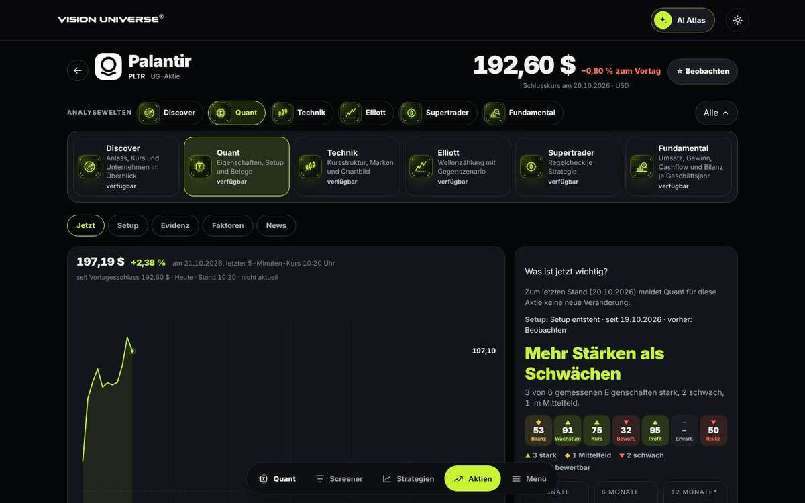 | 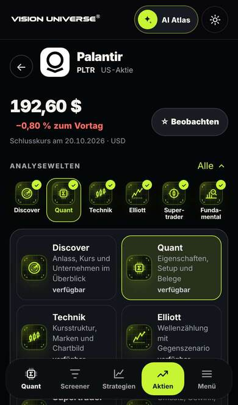 |

## Querschnitts-Schwachstellen

### Navigation

- **Drei Navigationsmodelle nebeneinander:**
  - Produktwelten: Kopf mit Logo, AI Atlas und Farbschalter, dazu das Dock. Auch auf dem Desktop öffnet sich das Menü nur über „Menü“ im Dock.
  - Dashboard: Kopf mit Schnelllinks (Dashboard, Screener, News, Quant, Elliott, Vorsorge) und „☰ Menü“, dazu eine eigene Leiste (Home, Research, Charting, Entdecken, Watchlist). Kein Dock.
  - Discover-Suche: Vollbild-Overlay ohne Kopf und ohne Dock.
- **Globales Menü:**
  - Es hat acht Welten und „Weitere Produkte“.
  - Technik fehlt.
  - Das Dashboard steckt unter „Weitere Produkte“, obwohl es im Kopf des Dashboards als erster Punkt steht.
- **Dock zeigt den falschen Bereich als aktiv:**
  - Supertrader-Aktienseite: „Signale“.
  - Technik-Übersicht `/quant/#/chartlagen`: „Aktien“ unter Quant.
  - Technik-PLTR: „Elliott“, die Kopfzeile sagt „← Elliott“.
- **Doppelte Funktion:** Es gibt zwei Screener, den „Quant Screener“ (dunkel) und den „Screener“ (hell). Die Quant-Methodik erklärt deshalb eigens „Quant, Screener, Discover – was ist was?“.
- **Unterseiten ohne eigenen Inhalt:**
  - Fundamental: „Entdecken“ und „Suche“ zeigen dieselbe Seite wie die Startseite (gleiche Wortzahl und Höhe), nur mit Fokus im Suchfeld.
  - Elliott: „Suche“ zeigt ebenfalls nur die Startseite.
  - Screener: „Filter hinzufügen“ und „Treffer“ zeigen dieselbe Ansicht.

| Menü Desktop (Dock → Menü) | Menü iPhone | Dashboard: eigener Kopf und eigene Leiste |
|---|---|---|
| 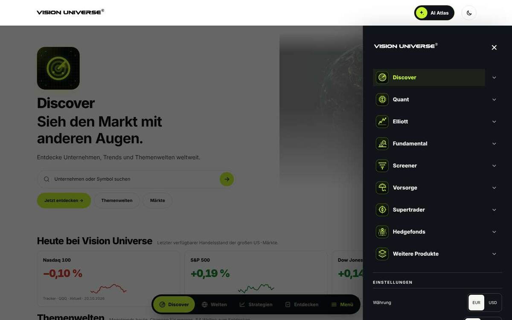 | 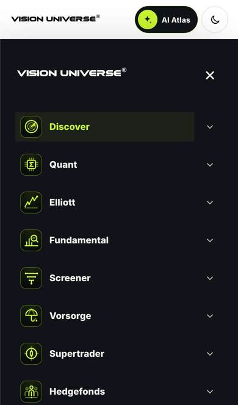 |  |

### Dieselbe Aktie, sieben Gesichter

Name und Überschrift (H1) von PLTR je Welt:

| Welt | Name | H1 |
|---|---|---|
| Discover | „Palantir Technologies Class A“ | „Palantir Technologies Class A“ (sehr groß, auf dem iPhone 3 Zeilen) |
| Quant | „Palantir“ | „Palantir“ |
| Supertrader | „Palantir Technologies Inc - Class A“ (iPhone: abgeschnitten „…Inc - Cl…“) | „PLTR“ |
| Fundamental | „Palantir Technologies Class A“ | „Palantir Technologies Class A“ |
| Hedgefonds | „Palantir Technologies Inc“ | „Palantir Technologies Inc“ |
| Technik / Elliott | „Palantir (PLTR)“ nur in der Kopfzeile | **„Aufwärts“** |

**Preis und Zeitstand.** Aufnahmen im Abstand weniger Minuten:

| Welt | Gezeigter Preis | Zeitangabe |
|---|---|---|
| Discover | 197,61 $ (live) | „Markt geöffnet · Live“ |
| Quant (Kopf) | 192,60 $ | „Schlusskurs am 20.10.2026“ |
| Quant (Chart darunter) | 197,19 $ | „nicht aktuell“ |
| Supertrader | 197,19 USD | „IEX verzögert 21.10.“, daneben das Banner „Kurse vom 20.10. · aktuell“ |
| Technik / Elliott | – | Stand 16.10.2026, „2 Handelstage alt“ |
| Discover-Suche | „+8,1 %“ | ohne Zeitraum, obwohl die Seite danach „+2,6 % heute“ zeigt |

Für einen neuen Nutzer ist am Quant-Kopf nicht erkennbar, welcher der beiden Preise gilt.

**Farbschema.** Ohne eigene Wahl starten die Welten unterschiedlich:

| Schema | Welten | Grund |
|---|---|---|
| Dunkel | Quant, Technik, Elliott, Supertrader, Fundamental | Seiten setzen `theme="dark"` als Vorgabe, z. B. `quant/index.html:31`, `elliott/index.html:18` |
| Hell | Discover, Hedgefonds, Vorsorge, Screener, Dashboard, Startseite (dunkel) | – |

Die VU3-Prüfung sichert nur, dass ein **gewähltes** Schema erhalten bleibt. Der erste Eindruck ist ein Wechsel hell → dunkel → hell beim Gang Discover → Quant → Hedgefonds.

**Schreibweisen.** „SuperTrader“ im Hero, „Supertrader“ in Menü und Dock. „Discovery“ in einem Supertrader-Link.

### Kleinere visuelle Fehler

- **Discover PLTR, iPhone:** „Zur Watchlist“ ragt über den rechten Rand.
- **Technik/Elliott PLTR:** Nach dem Laden liegt ein sichtbarer Fokusrahmen um die H1 „Aufwärts“.
- **Vorsorge „Vergleichen“ (Desktop):** Die Überschrift bricht mit einem einzelnen „–“ in einer eigenen Zeile um.
- **Technik-Übersicht:** Sie bietet den Filter „Klare Elliott-Strukturen (0)“ an, der leer ist.
- **Supertrader „Quellen“:** Der Text zeigt Arbeitsjargon für Nutzer, z. B. „SEARCH_RESULT_MATCH“ und „Source-Fidelity-Pass“.
- **Discover-Start:** Das Globus-Bild wirkt im hellen Schema ausgewaschen und grau.

| Vorsorge Vergleichen | Supertrader Quellen |
|---|---|
| 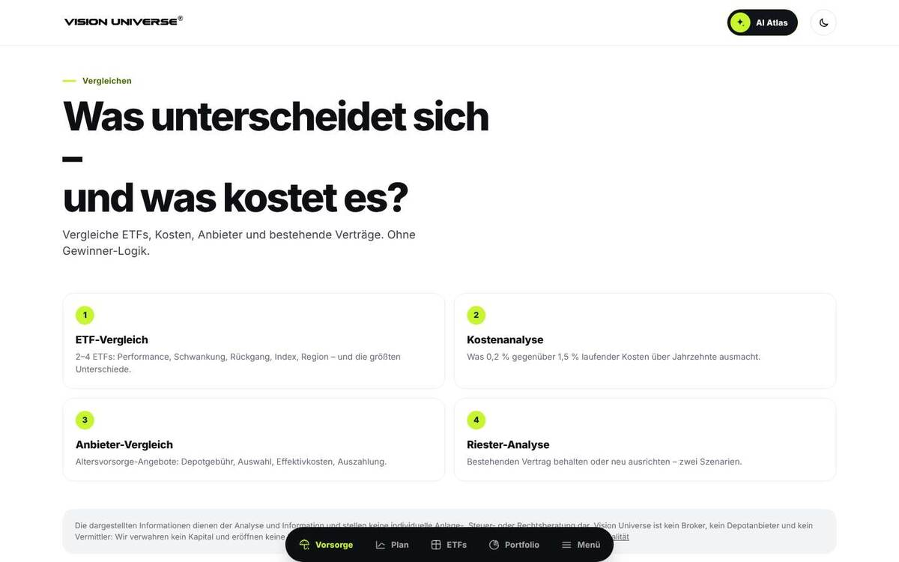 | 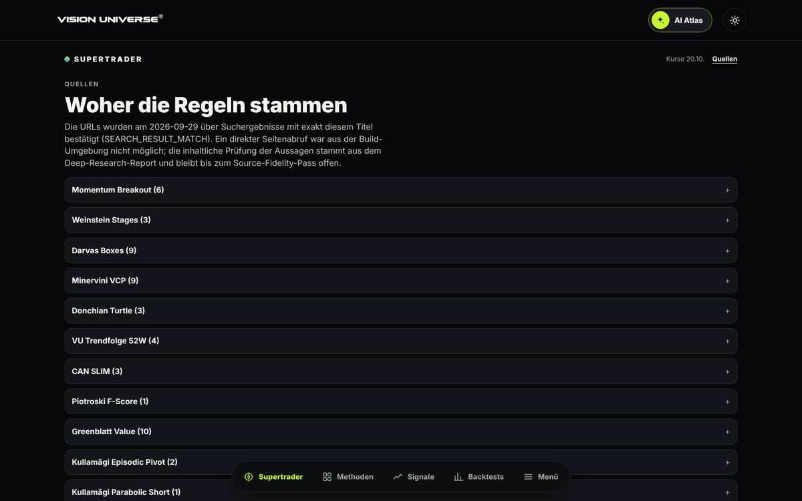 |

### Textmenge und Seitenlänge

Ohne aufgeklappte Details. „Bildschirme“ ist die Seitenhöhe geteilt durch die Fensterhöhe.

| Seite | Wörter | Desktop (Bildschirme) | iPhone (Bildschirme) |
|---|---:|---:|---:|
| Discover PLTR | 2.244 | 15,2 | 18,0 |
| Quant PLTR | 2.126 | 12,0 | 17,7 |
| Elliott PLTR (Profi) | 1.243 | 7,5 | 12,1 |
| Hedgefonds PLTR | 1.678 | 7,7 | 9,1 |
| Fundamental PLTR | 948 | 4,9 | 9,9 |
| Technik PLTR | 601 | 4,4 | 5,6 |
| Supertrader PLTR | 272 | 1,9 | 2,1 |
| Hedgefonds Start | 1.504 | 5,2 | 10,6 |
| Elliott Start | 1.738 | 3,4 | 3,9 |
| Quant Start | 1.165 | 4,8 | 7,8 |
| Startseite `/` | 437 | 15,3 | 27,6 |

Aufgeklappt wächst Quant PLTR auf etwa 5.000 Wörter und 39 iPhone-Bildschirme, Hedgefonds Start auf 6.900 Wörter.

| Discover PLTR, Details offen (Ausschnitt 9.000 px) | Quant PLTR, Details offen (Ausschnitt 9.000 px) |
|---|---|
| 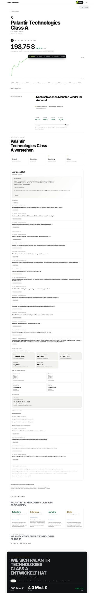 | 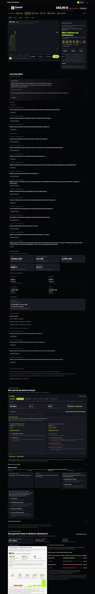 |

## Die Welten im Einzelnen

Je Welt eine Übersicht aller Unterseiten (oben der Bildschirm bei Ladeende) und die wichtigsten Einzelbilder.

### Discover
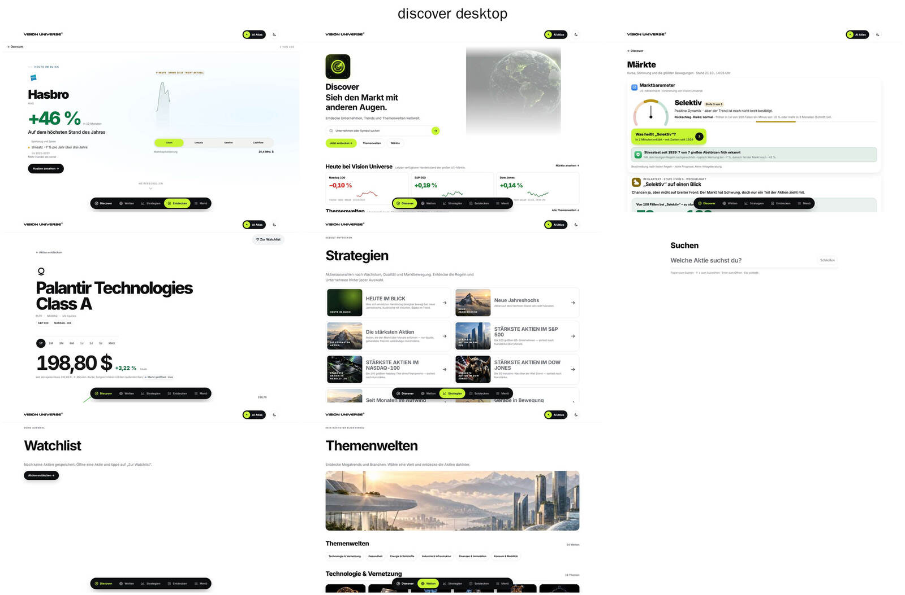
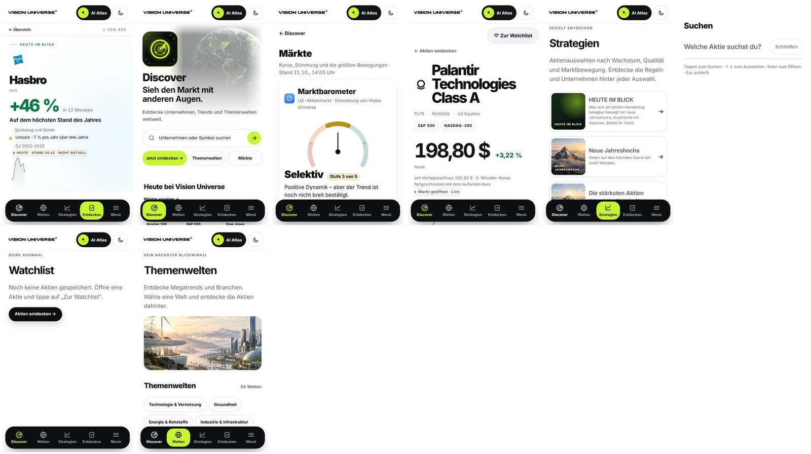

| Stärken | Schwächen |
|---|---|
| Großer Preis (197,61 $), Index-Kacheln, „+46 %“ in Entdecken, Marktbarometer als Tacho | PLTR-Seite 18 iPhone-Bildschirme lang |
| Klare Leerzustände (Watchlist) | Kein Weg zu Quant, Supertrader, Fundamental oder Hedgefonds |
| | Einziger Technik-Link tief in einem Abschnitt |
| | Suche als Overlay ohne Navigation |

PLTR ganz (Ausschnitt): 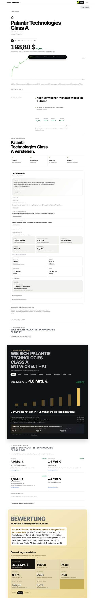

### Quant
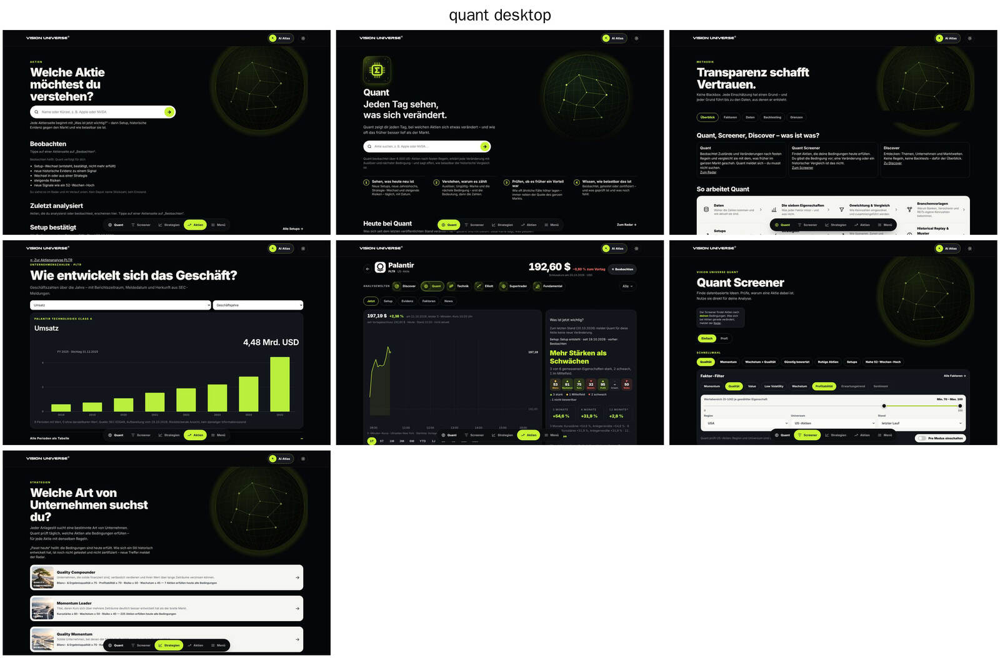
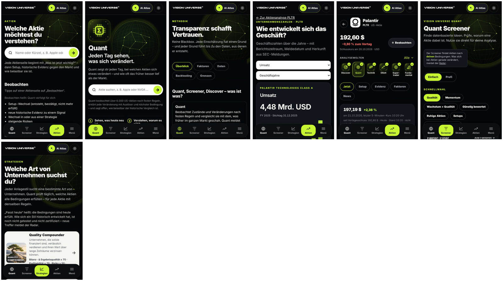

| Stärken | Schwächen |
|---|---|
| Einzige Welt mit Analysewelten-Navigator | Zwei Preise im Kopf |
| Eigenschafts-Kacheln (53/91/75/32/95/–/50) | Text „3 von 6 gemessenen Eigenschaften“ neben 7 Kacheln |
| Reiter Jetzt/Setup/Evidenz/Faktoren/News | Startseite 7,8 iPhone-Bildschirme Erklärtext |
| | Zweiter Screener neben der Screener-Welt |

PLTR ganz (Ausschnitt): 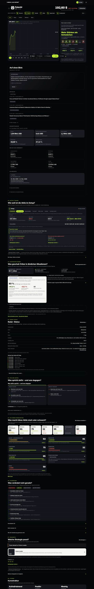

### Technik

| Stärken | Schwächen |
|---|---|
| Übersicht „Technische Lagen“ als dichte Kachelliste mit Zonen | Keine eigene Welt: kein Menüeintrag, kein Dock, kein Icon |
| PLTR mit drei Szenario-Reitern | Übersicht unter Quant, Aktie unter Elliott |
| | PLTR beginnt mit „Keine belastbare Elliott-Lesart“ |
| | H1 „Aufwärts“ statt Aktienname |
| | Datenstand 16.10. |

### Elliott
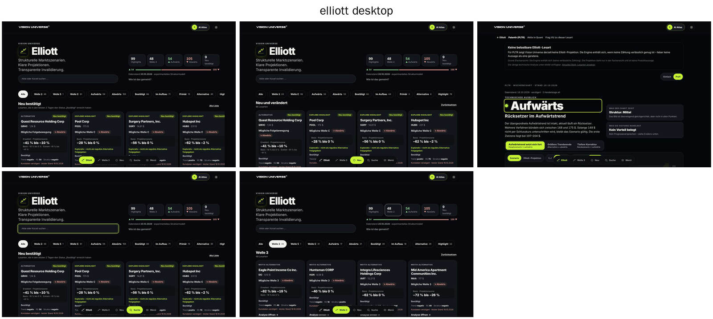
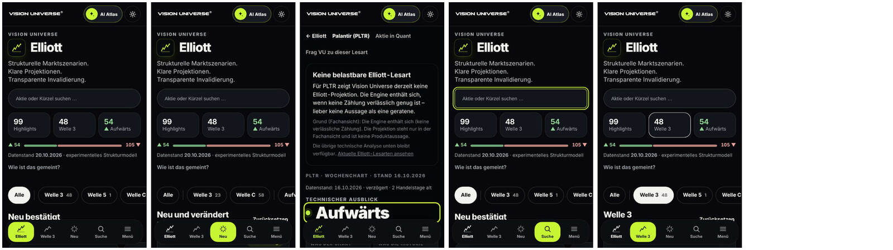

| Stärken | Schwächen |
|---|---|
| Bestes Visual-First-Beispiel: Kennzahl-Kacheln 99/48/54, Richtungsbalken 54 ▲ / 105 ▼, Filter-Chips | Aktienseite nur mit Rückweg zu Quant |
| Kompakte Startseite (3,9 iPhone-Bildschirme) | Für PLTR keine Lesart, Profi-Ansicht zeigt dennoch 12 Bildschirme |
| | „Suche“ ohne eigene Ansicht |

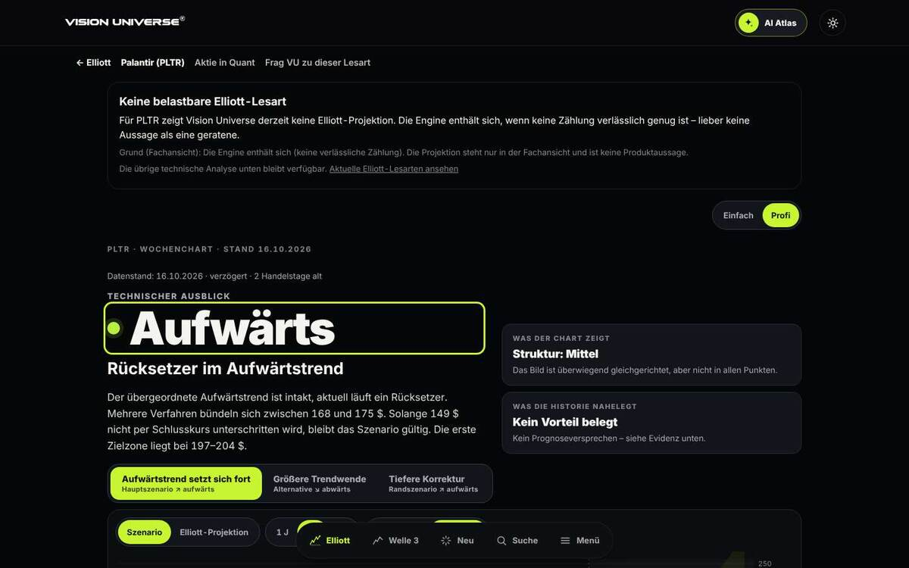

### Supertrader
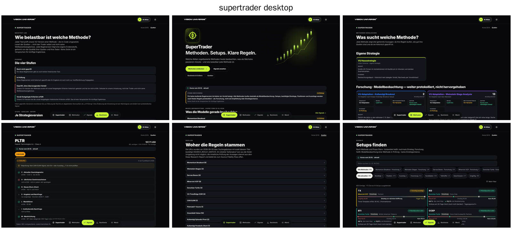
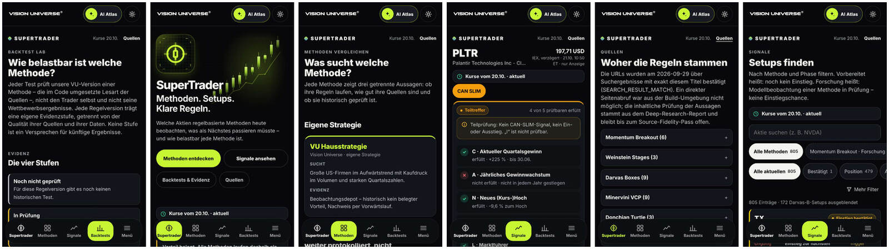

| Stärken | Schwächen |
|---|---|
| CAN-SLIM-Prüfliste mit Haken/Kreuz | Aktienseite ohne große Kennzahl, ohne Chart, ohne Navigator |
| Protokoll als Zeitleiste | Nur ein Link (nach „Discovery“) |
| | Dock zeigt „Signale“ |
| | „N · Neues Hoch: erfüllt · -9,6 % zum Hoch“ ist ohne Erklärung widersprüchlich |
| | Methoden und Backtests sehr textlastig |

### Fundamental
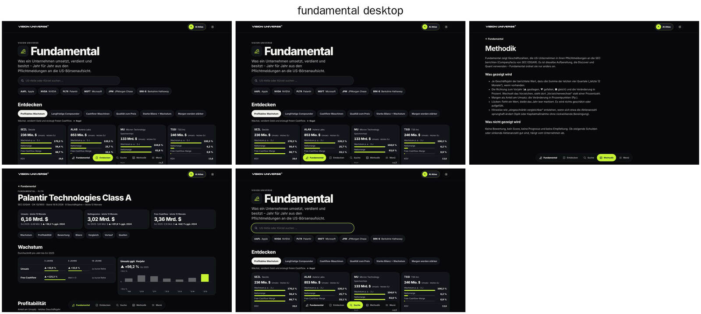
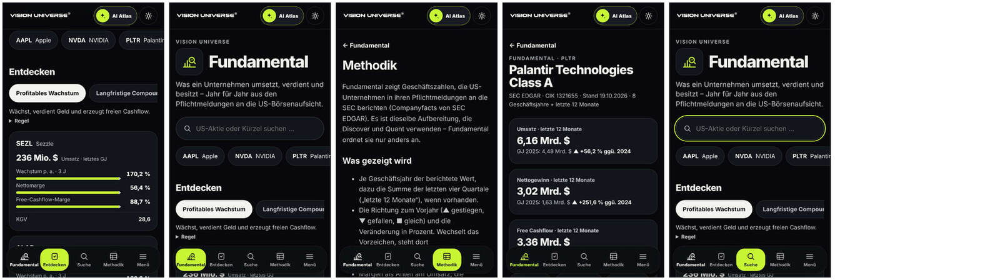

| Stärken | Schwächen |
|---|---|
| Drei große Kennzahlen (6,16 Mrd. $ / 3,02 Mrd. $ / 3,36 Mrd. $) | Linkliste unvollständig, „Elliott“ zeigt auf Technik |
| Wachstums-Balken, Abschnitts-Chips | Entdecken und Suche ohne eigene Ansicht |
| Entdecken-Kacheln mit Balken | Methodik 1,5 Bildschirme, fast leer |

### Vorsorge
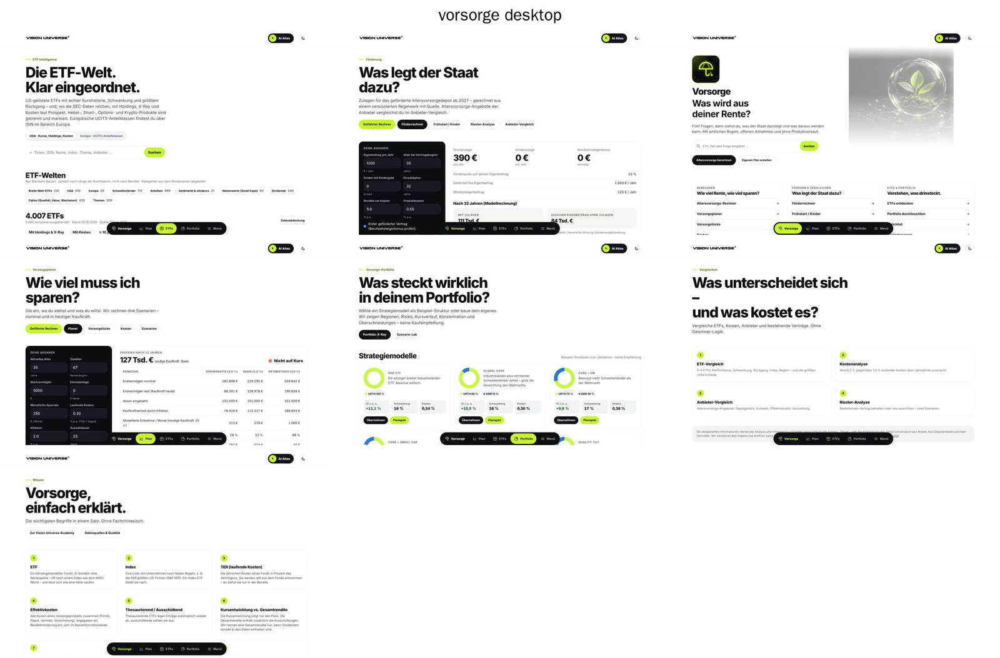
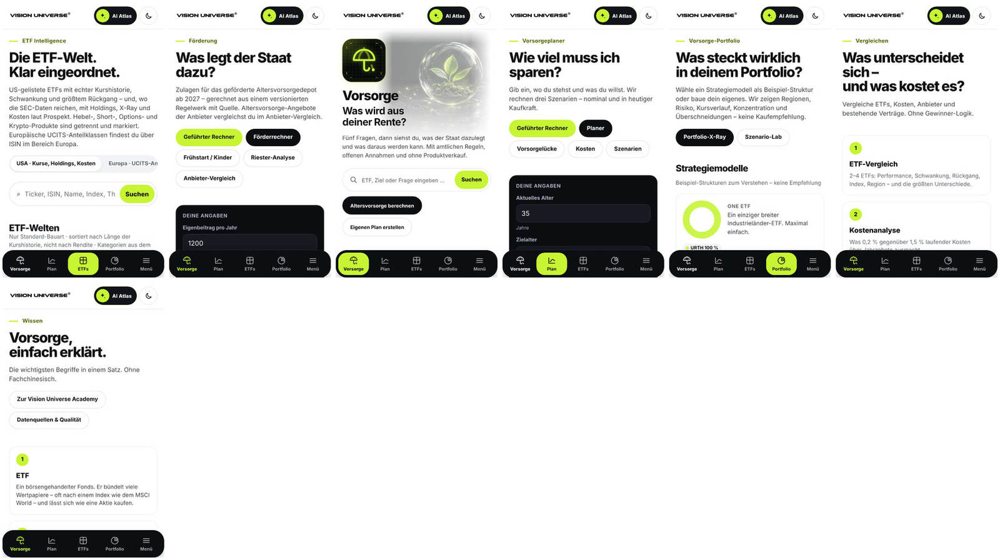

| Stärken | Schwächen |
|---|---|
| Rechner mit großen Ergebnissen (390 € Zulage, 127 Tsd. €) | Umbruch der Überschrift in „Vergleichen“ |
| Ringdiagramme der Strategiemodelle | „ETFs“ 11,9 iPhone-Bildschirme Text vor der Liste |
| Nummerierte Wissenskarten | |

### Screener
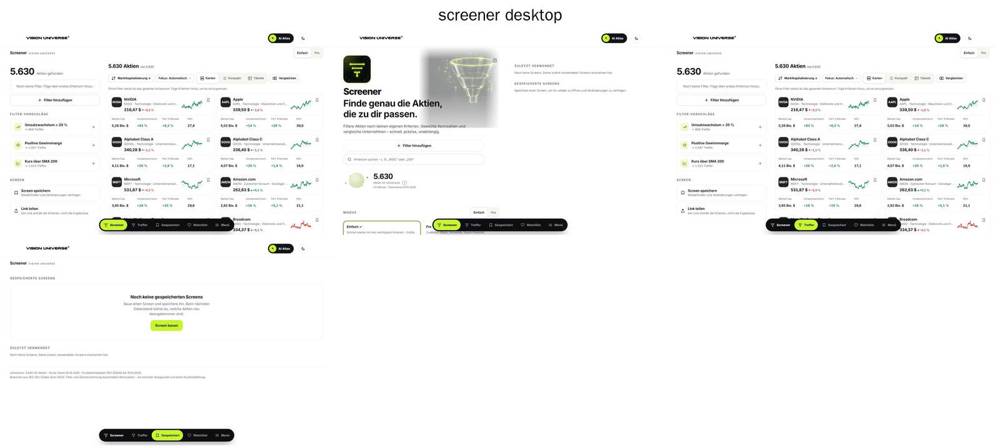

| Stärken | Schwächen |
|---|---|
| Große Trefferzahl 5.630, Karten mit Sparkline, Filter-Vorschläge mit Trefferzahl | „Filter hinzufügen“ = „Treffer“ |
| Wenig Text (156 Wörter Start) | Konkurrenz zum Quant Screener |
| | Nicht aus Aktienseiten erreichbar |

### Hedgefonds
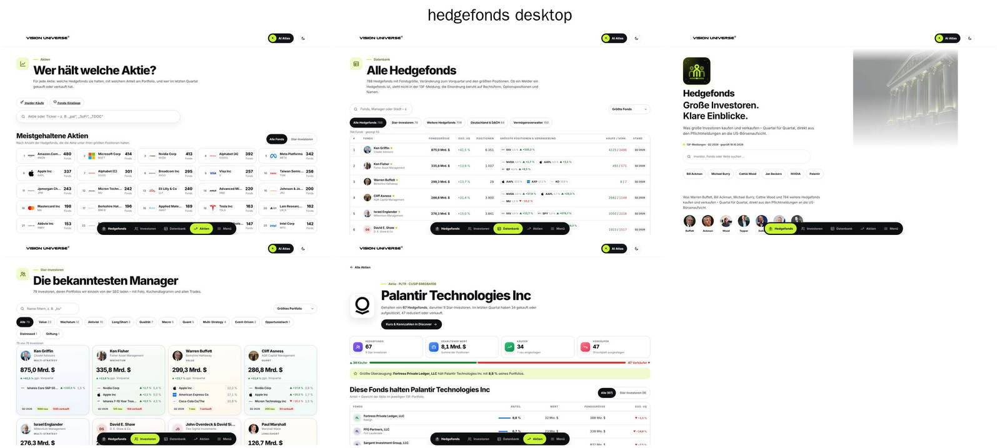
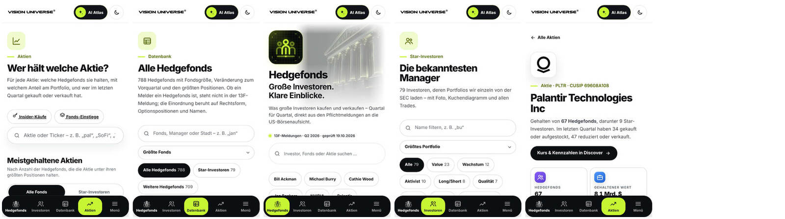

| Stärken | Schwächen |
|---|---|
| Rankings mit Rang, Logos und Fotos | Startseite 10,6 iPhone-Bildschirme, 30 Details |
| PLTR mit vier Kennzahl-Kacheln (67 Fonds, 8,1 Mrd. $, 34 Käufer, 47 Verkäufer) und Käufer/Verkäufer-Balken | PLTR nur mit Link nach Discover, nicht im Navigator |
| | URL wechselt auf CUSIP |

### Dashboard
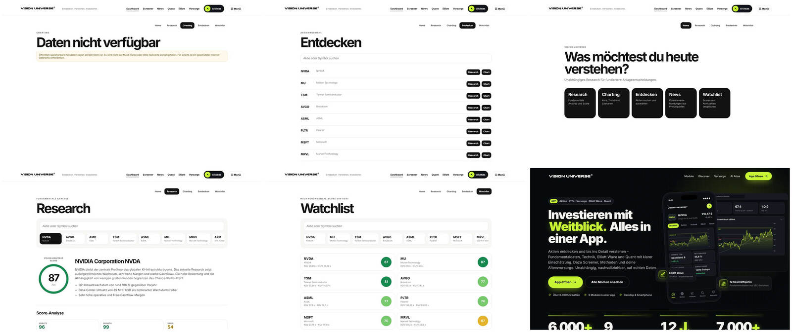
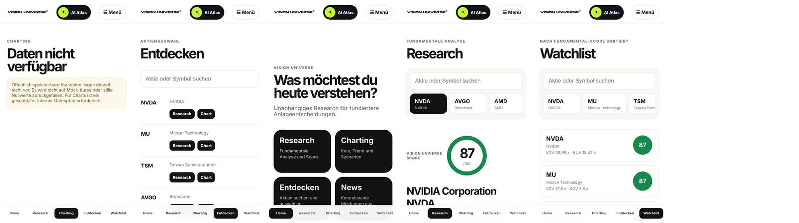

| Charting: tot | Research: eigener Score | Watchlist: feste Scores |
|---|---|---|
| 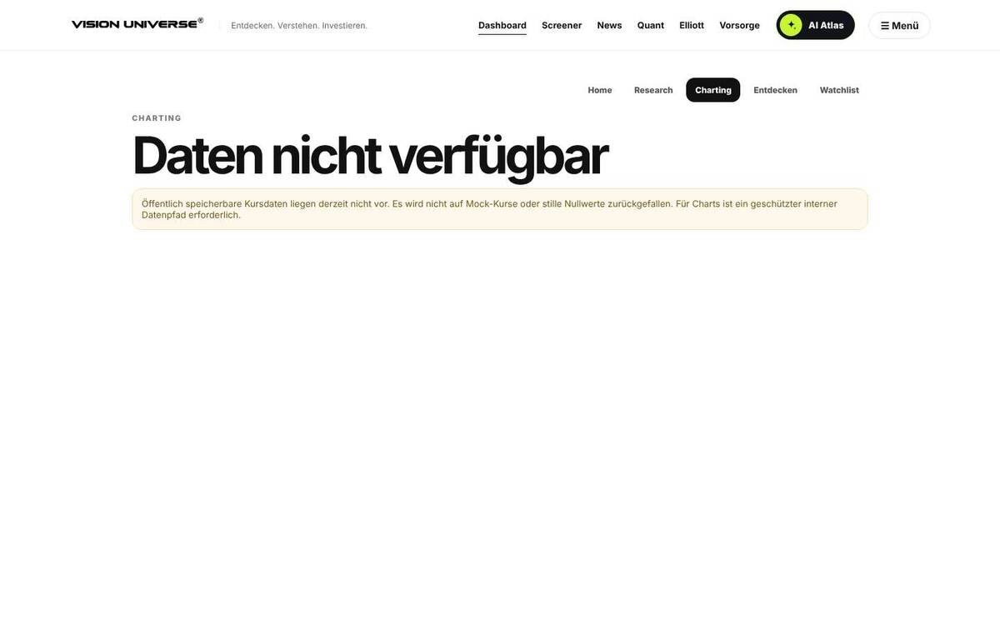 | 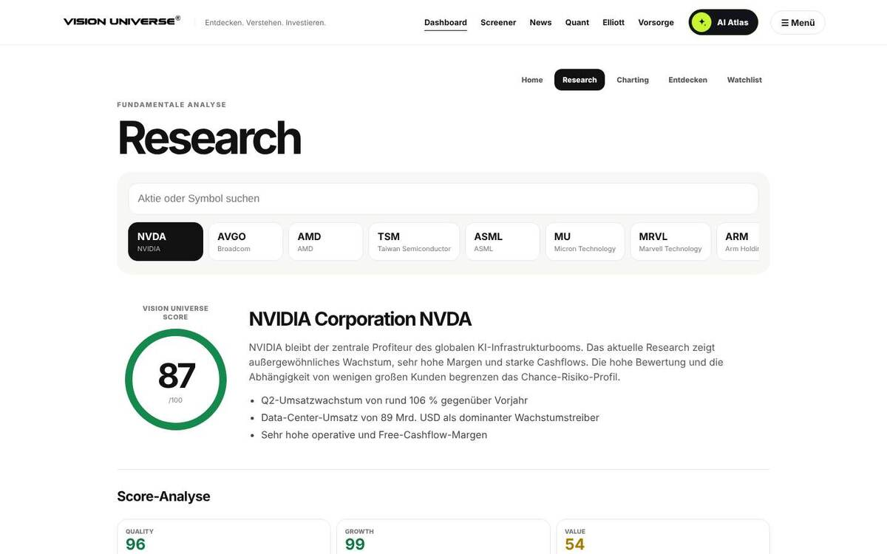 | 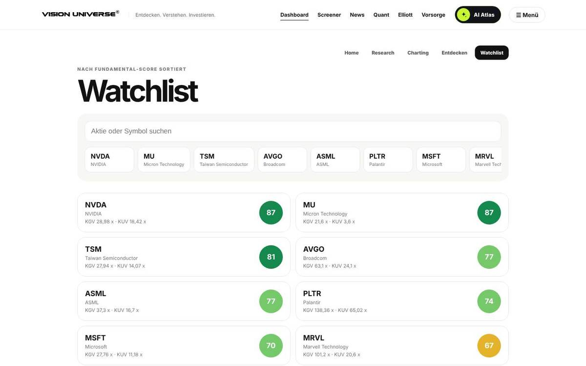 |

Befunde:
- **Startseite:** 42 Wörter, oben eine große Leerfläche, keine Suche.
- **Research:** Ein „Vision Universe Score 87/100“ für 8 feste Aktien, daneben Quality/Growth/Value-Werte. Das widerspricht Quant (sieben Eigenschaften, Gesamtnote „noch nicht freigegeben“) und Fundamental („kein Score“).
- **Charting:** „Daten nicht verfügbar“, Sackgasse.
- **Watchlist:** Eine vorbelegte Liste mit Scores (PLTR 74).
- **Erreichbarkeit:** Die Landingpage öffnet mit „App öffnen“ nicht das Dashboard, sondern Discover.

## Erste fünf Minuten eines neuen Nutzers (iPhone)

**Weg 1: Startseite → App → Palantir.**

| 1 Startseite | 2 „App öffnen“ → Discover | 3 Suche „Palantir“ | 4 Aktienseite |
|---|---|---|---|
|  |  | 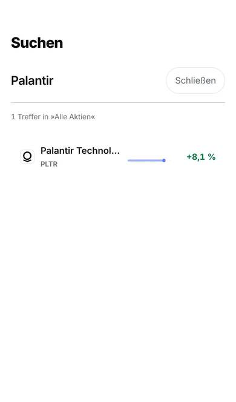 | 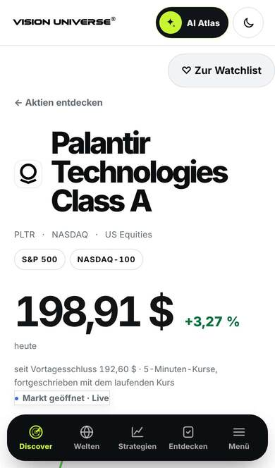 |

Der Weg zur Aktie ist kurz: vier Schritte, die Suche findet sofort. Danach endet er:
- Auf der Discover-Seite gibt es keinen sichtbaren Link zu Quant.
- Wer die Quant-Analyse sehen will, braucht fünf Aktionen: Dock „Menü“ → Quant → Suchfeld → „PLTR“ tippen → Treffer wählen. Der Aktienkontext geht dabei verloren.
- Zu Technik muss man etwa 12 Bildschirme scrollen, bis zum Link „Chartbild öffnen“.

**Weg 2: Quant → PLTR → Analysewelten → Supertrader.**

| 1 Quant-Start | 2 Suche | 3 Aktienseite | 4 Supertrader |
|---|---|---|---|
| 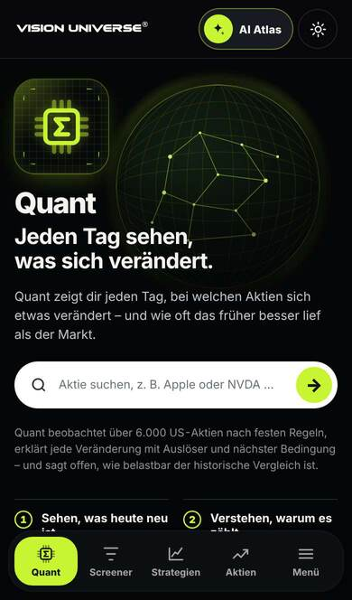 | 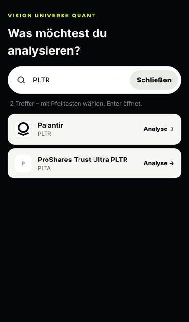 |  | 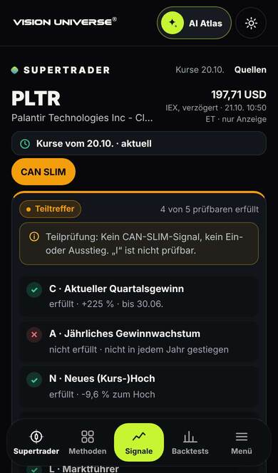 |

Der Hinweg ist gut: ein Tippen im Navigator. Auf Supertrader dann:
- Es gibt keinen Rückweg zu Quant (0 Links). Es bleibt nur „Zurück“ im Browser oder „Discovery“.
- Das Schema wechselt nicht (beide dunkel), aber Name und Preis wechseln.

**Weg 3: Dashboard.** 

Die Startseite hat weder ein Suchfeld noch ein Dock. Die Kacheln führen in die Altwerkzeuge, eines davon („Charting“) in eine leere Seite.

**Weg 4: Technik PLTR (aus dem Quant-Navigator).** 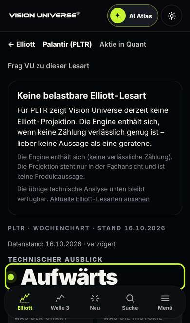

Der erste Eindruck ist eine Absage: „Keine belastbare Elliott-Lesart“. Darunter folgt „Aufwärts“ mit Fokusrahmen. Sichtbare Wege: nur „Aktie in Quant“ und die Methodik.

**Bewertung.** In fünf Minuten findet ein neuer Nutzer eine Aktie zuverlässig. Er erfährt aber nicht, dass es zu ihr sieben Blickwinkel gibt, außer er landet zufällig auf der Quant-Seite. Discover ist der Einstieg der Landingpage, dort fehlt der Navigator. Damit fehlt er genau dort, wo die meisten Nutzer ankommen.

## Soll / Ist: VU3-Masterplan

Soll laut Auftrag: Icons, große Kennzahlen, Rankings, weniger Text, Details auf Klick, konsistente Navigation.
Legende: ✅ erfüllt · ◐ teilweise · ✗ nicht erfüllt.

| Welt | Icons | Große Kennzahlen | Rankings | Weniger Text | Details auf Klick | Konsistente Navigation |
|---|---|---|---|---|---|---|
| Discover | ✅ | ✅ | ◐ | ✗ PLTR 2.244 W. / 18 Bildsch. | ✅ 17 Details | ✗ kein Navigator |
| Quant | ✅ | ✅ | ◐ | ✗ PLTR 2.126 W. / 17,7 Bildsch. | ✅ 24 Details | ◐ Navigator ja, aber zwei Preise und doppelter Screener |
| Technik | ✗ kein eigenes | ◐ Zonen | ✅ Lagen-Liste | ✅ | ◐ | ✗ keine eigene Welt |
| Elliott | ✅ | ✅ | ✅ | ◐ | ✅ Profi | ◐ nur Rückweg Quant |
| Supertrader | ✅ | ✗ auf der Aktienseite | ◐ | ✗ Methoden/Backtests | ◐ | ✗ ein Link, falsches Dock-Ziel |
| Fundamental | ✅ | ✅ | ✅ | ✅ | ◐ | ◐ eigene, unvollständige Liste |
| Vorsorge | ✅ | ✅ | ◐ | ✅ | ◐ | ✅ |
| Screener | ✅ | ✅ | ✅ | ✅ | – | ◐ zwei Ansichten identisch, Doppelung |
| Hedgefonds | ✅ | ✅ | ✅ | ✗ Start 10,6 Bildsch. | ✅ 30 Details | ◐ ein Link, nicht im Navigator |
| Dashboard | ✗ | ◐ Scores | ◐ | ✅ | ✗ | ✗ eigenes System, kein Dock |

Gesamtbild:
- Die Bausteine „Icons“ und „große Kennzahl“ sind weitgehend umgesetzt (VU3 #759–#783).
- „Weniger Text“ ist auf den Aktienseiten von Discover und Quant nicht erreicht.
- „Konsistente Navigation“ ist das größte offene Soll.

## Prioritäten

**P1: Verbindung und Konsistenz (größter Nutzen, betrifft jeden Nutzer)**
1. **Aktien-Navigator auf alle Aktienseiten:**
   - Seiten: Discover, Technik/Elliott, Supertrader, Fundamental, Hedgefonds.
   - Er ersetzt die Einzel-Links. Hedgefonds kommt als Modul dazu.
   - Discover zuerst, weil die Landingpage dorthin führt.
2. **Dashboard-Altwelt entscheiden:**
   - Entweder in die Produktwelten überführen (Dock, kein eigener Score) oder aus dem Menü nehmen.
   - Die Seite „Charting: Daten nicht verfügbar“ und der „Vision Universe Score“ widersprechen dem 3.0-Stand.
3. **Ein Kopf je Aktie:** gleicher Name, Ticker und Logo, ein Preis mit eindeutigem Zeitstand. Das betrifft den Quant-Kopf (192,60 $ vs. 197,19 $) und das Supertrader-Banner „20.10. aktuell“ neben dem Kurs vom 21.10.

**P2: Orientierung**

4. **Technik als erkennbare Welt:** Menüeintrag, eigenes Dock-Ziel und eigenes Icon im Kopf, oder sichtbar als Modus von Elliott benennen. Die H1 auf der Aktienseite sollte der Aktienname sein, nicht „Aufwärts“.
5. **Dock-Zustände korrigieren:**
   - Supertrader-Aktie zeigt „Signale“, Technik-Übersicht zeigt „Aktien“.
   - Unterseiten ohne eigenen Inhalt zusammenlegen oder unterscheiden: Fundamental „Entdecken“/„Suche“, Elliott „Suche“, Screener „Filter“/„Treffer“.
6. **Ein Farbschema als Vorgabe** für alle Welten, solange der Nutzer nichts wählt.
7. **Zwei Screener** (Quant Screener / Screener) für Nutzer klar abgrenzen oder zusammenführen.

**P3: Inhalt und Feinschliff**

8. **Aktienseiten Discover und Quant kürzen:** Ziel unter 8 iPhone-Bildschirme ohne Details. Längere Erklärungen hinter „Mehr“.
9. **Supertrader-Aktienseite:** große Kennzahl oder kleiner Chart. Den Widerspruch „Neues Hoch erfüllt · -9,6 % zum Hoch“ erklären.
10. **Kleinfehler:**
    - „Zur Watchlist“-Überlauf (iPhone)
    - Fokusrahmen um „Aufwärts“
    - Umbruch in Vorsorge „Vergleichen“
    - leerer Filter „Klare Elliott-Strukturen (0)“
    - Jargon in Supertrader „Quellen“
    - Schreibweisen „SuperTrader“ und „Discovery“
    - „+8,1 %“ ohne Zeitraum in der Discover-Suche

Die Umsetzung braucht nach `CLAUDE.md` produkteigene PRs:
- Discover, Supertrader (Gate A) und Company Intelligence sind isoliert.
- Der Navigator liegt in `assets/` und wird je Welt eingebunden.

## Wiederholung

Die Aufnahme lief mit drei Wegwerf-Skripten außerhalb des Repositorys, nicht committet:
- `login`: Formular-Login, speichert den Browserzustand nur lokal.
- `capture`: Routenliste mit Klick-, Aufklapp- und Scroll-Schritten, Desktop und iPhone.
- `journey`: Nutzerwege.

Für eine dauerhafte Prüfung bietet sich `scripts/quality/vu3-regression-qa.mjs` an. Abschnitt 1 („Wege zwischen den Welten“) prüft bisher diese Wege:
- Quant ↔ Elliott
- Quant → Supertrader und Discover
- Discover → Elliott
- Fundamental → Quant-Zahlen
- Hedgefonds → Discover
- Screener → Quant und Discover

Nicht verlangt werden:
- ein Rückweg von Supertrader oder Discover nach Quant
- ein Navigator auf allen Aktienseiten

Deshalb ist die Lücke im Gate grün.
