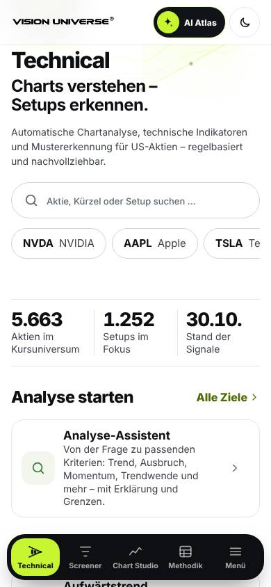
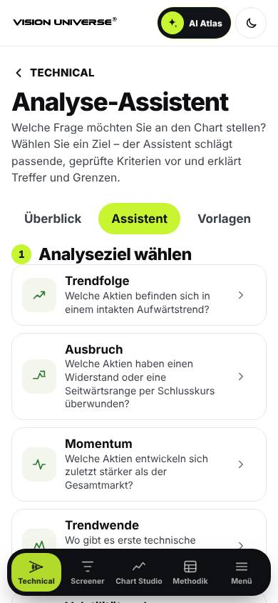
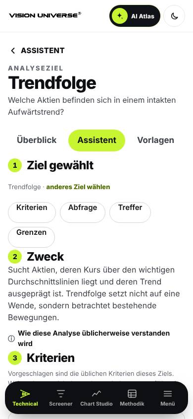
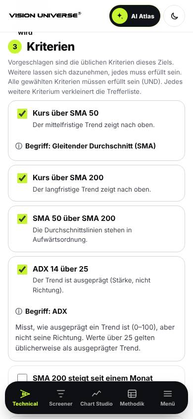
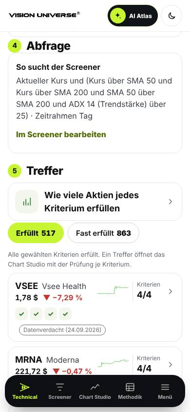
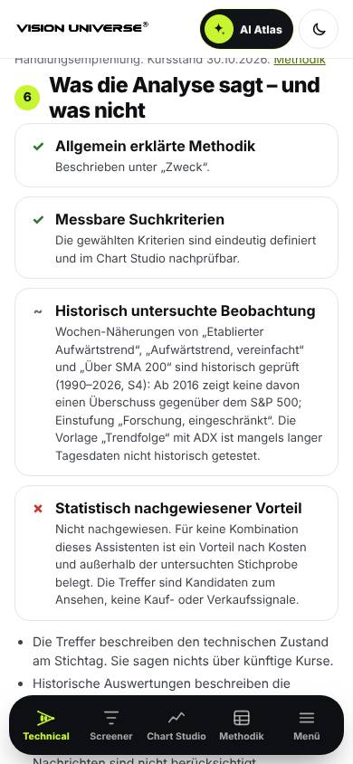
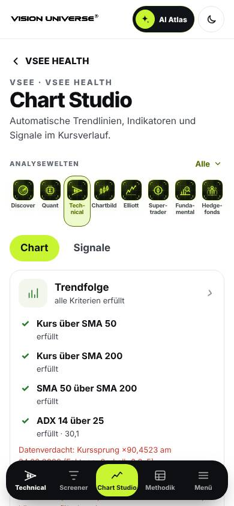
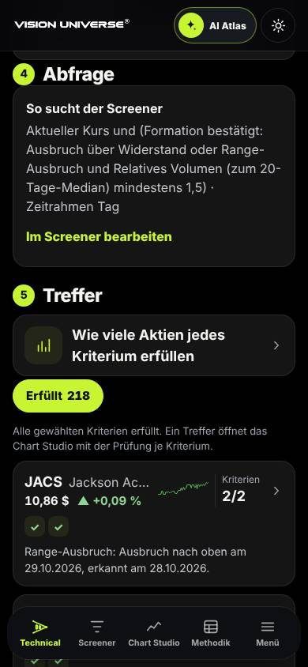
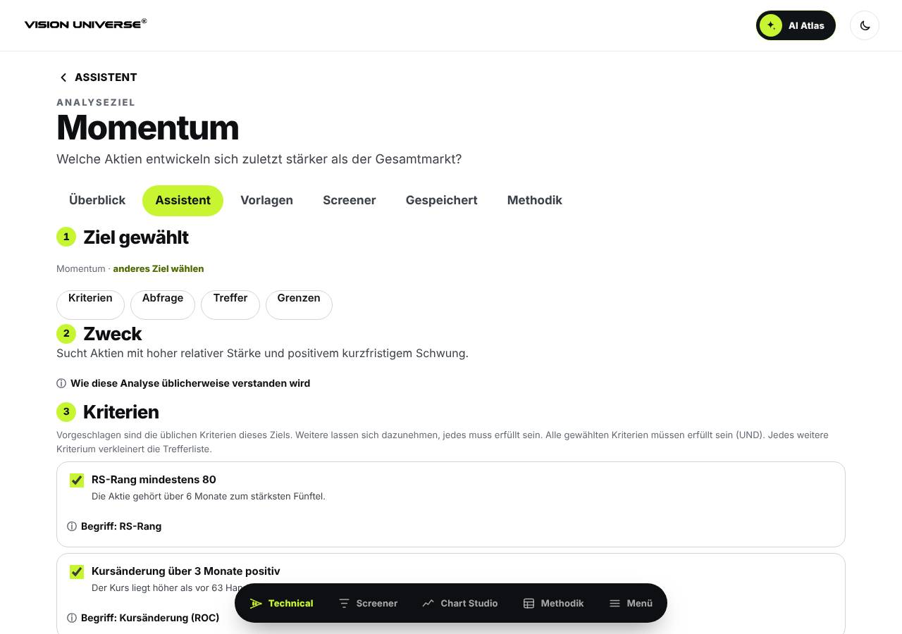
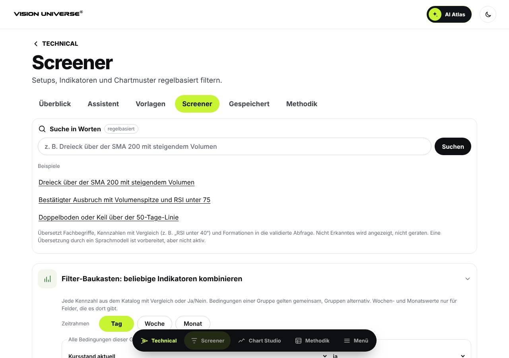

# Technical – Analyse-Assistent: Owner-Abnahmevorlage

Stand 02.11.2026 · PR #1245 · Datenstand 30.10.2026. Ausführliche Beschreibung: [TECHNICAL_ASSISTANT.md](TECHNICAL_ASSISTANT.md).

**Was abgenommen wird:**
- die neue Ansicht `#/assistent` innerhalb von Technical;
- die Texte der acht Analyseziele und der 21 Begriffe;
- die Einstiege: Reiter „Assistent“ und „Analyse starten“ auf der Startseite.

**Was nicht berührt wird:** Fachmodelle, Vorlagen, Screener-Felder und `technical/data`.

## 1. Abnahmekriterien

| # | Anforderung | Nachweis | Ergebnis |
|---|---|---|---|
| A1 | Acht Analyseziele | Test „acht Analyseziele“; Screenshot 02 | ✔ |
| A2 | Verständliche Sprache, Fachbegriffe erklärt | 21 Begriffe, jeweils beim ersten Kriterium; Sprachtest (kein Kauf, keine Rendite, keine Trefferquote, keine Prognose, keine Personennamen); Screenshot 04 | ✔, Texte zur Owner-Lektüre |
| A3 | Kriterien bearbeitbar | An/aus je Kriterium, die Adresse merkt die Auswahl (`k=`); Browser-QA: ein Kriterium dazunehmen ändert Treffer und Adresse | ✔ |
| A4 | Konsistente Screener-Abfrage | Test: Screener-Trefferzahl = „Erfüllt“ für jedes Ziel (Voreinstellung, alle Kriterien, ein Kriterium); Browser-QA vergleicht beide Zahlen; Screenshot 10 | ✔ |
| A5 | Korrekte Chart-Übergabe | Treffer → `#/chart/<T>?z=<Ziel>&k=…`, Prüfleiste mit Status und Werten je Kriterium, passende Schichten; Screenshot 07 | ✔ |
| A6 | Datenqualität gekennzeichnet | „Datenverdacht“ und „Datenfehler bestätigt“ in Trefferkarte und Prüfleiste (gemeinsame Trefferkarte mit den Vorlagen); Titel ohne aktuellen Kurs werden nicht eingeordnet und gezählt; Screenshot 07 | ✔ |
| A7 | Methodische Grenzen verständlich | Schritt 6: Methodik, Kriterien, historische Beobachtung, Vorteil „nicht nachgewiesen“, vier Grenzen; Screenshot 06 | ✔ |
| A8 | iPhone- und Desktop-QA | Browser-QA 66/66 (360/390/1280 px, hell und dunkel, kein seitliches Scrollen, keine Konsolenfehler); Screenshots 01–10 | ✔ |

## 2. Nutzerwege zum Selbsttest (iPhone, etwa 5 Minuten)

1. **Einstieg:** `/technical/` öffnen. Unter „Analyse starten“ auf **Analyse-Assistent** tippen (Screenshot 01). Die acht Ziele erscheinen (02).
2. **Trendfolge:** antippen.
   - Oben erscheinen „Ziel gewählt“ und Sprungmarken.
   - Unter „Zweck“ öffnet sich „Wie diese Analyse üblicherweise verstanden wird“ (03).
3. **Kriterium dazunehmen:** In „Kriterien“ den Haken bei **RS-Rang mindestens 70** setzen.
   - Die Trefferzahl sinkt.
   - Jede Trefferkarte zeigt nun 5 Haken.
   - „Begriff: RS-Rang“ aufklappen (04).
4. **Abfrage prüfen:** Unter „Abfrage“ steht „So sucht der Screener“ (05). Auf **Im Screener bearbeiten** tippen.
   - Der Screener zeigt „Aus dem Analyse-Assistenten“ und dieselbe Trefferzahl (10).
   - Zurück.
5. **Treffer ansehen:**
   - Die Sprungmarke **Treffer** führt zur Liste. „Fast erfüllt“ zeigt Aktien, denen genau ein Kriterium fehlt, mit dessen Namen.
   - Ersten Treffer antippen. Das Chart Studio öffnet sich mit der Prüfleiste „Trendfolge“ (07): ✓/✗/? je Kriterium, Zahlenwerte, gegebenenfalls Datenhinweis.
6. **Grenzen:** zurück, Sprungmarke **Grenzen** (06).
   - „Statistisch nachgewiesener Vorteil: Nicht nachgewiesen.“
   - Darunter die historische Einordnung (S4: ab 2016 kein Überschuss gegenüber dem S&P 500).
7. **Dunkel:** Farbschema wechseln, **Ausbruch** öffnen (08).
8. **Desktop:** `#/assistent/momentum` (09).

## 3. Befunde aus der Abnahmeprüfung (02.11.)

| Befund | Behandlung |
|---|---|
| „Trendfolge“ war nach ADX sortiert. Ganz oben standen fast unbewegte Titel mit extremem ADX (z. B. PGAC, ADX 92, 0 % Tagesänderung). | Sortierung des Ziels auf RS-Rang umgestellt. Nur die Reihenfolge der Anzeige ändert sich, nicht die Trefferliste und kein Fachmodell. |
| Die Prüfleiste im Chart sagte beim Analyseziel „Die Vorlage beschreibt …“. | Für Analyseziele steht jetzt der Grenztext des Assistenten. |
| Bei „Volatilität und Konsolidierung“ stehen naturgemäß sehr ruhige Titel oben; das können Übernahmekandidaten oder Mantelgesellschaften sein. | Hinweis im Methodiktext ergänzt. Kein Ausschluss, denn eine Ausschlussregel wäre ein Fachmodell. |
| Der erste Trendfolge-Treffer (VSEE) trägt „Datenverdacht: Kurssprung ×90“. | Die Kennzeichnung wirkt wie vorgesehen (#1180). Ob gekennzeichnete Titel in Vorlagen und Zielen nach unten sortiert oder ausgeblendet werden, ist Option C aus Completion 2.0 und **nicht freigegeben**. Owner-Entscheidung, siehe §4. |
| Die Seite ist auf dem iPhone lang (rund 7.000 px mit 30 Treffern). | Schritt 1 mit Sprungmarken (Kriterien, Abfrage, Treffer, Grenzen); Browser-QA prüft den Sprung zu den Treffern. |
| Zwei Ziele beschrieben ihre Zusatzkriterien mit „oder“ (Trendwende, Unterstützung und Widerstand), alle Kriterien gelten aber gemeinsam (UND). | Zwecktexte korrigiert: „lassen sich als weitere Bedingungen dazunehmen“. Dazu sprachliche Endprüfung: kein „Swings“, MACD „zuletzt positiv“ statt „hat gedreht“, Ruhephasen „nach verbreiteter Lesart“ statt „oft“. |
| Datenverdächtige Titel stehen gehäuft oben, weil ein Kurssprung die relative Stärke aufbläht (Trendfolge: 3 der ersten 30, Kombination: 4). | Hinweis über der Trefferliste mit der Zahl gekennzeichneter Treffer. Die Nachrangsortierung liegt als eigener Entscheidungs-PR vor (T-2). |

## 4. Entscheidungen für den Owner

| # | Frage | Empfehlung |
|---|---|---|
| T-1 | Texte der Ziele und Begriffe freigeben (A2) | freigeben. Alle Texte stehen an einer Stelle: `technical/engine/assistant.js`, `GOALS` und `TERMS` |
| T-2 | Titel mit Datenverdacht in Vorlagen und Zielen nach unten sortieren (Option C, teilweise) | sortieren, nicht ausblenden. Eigener Fachmodell-PR mit Vorher/Nachher |
| T-3 | #1245 mergen | nach T-1 |

## 5. Screenshots

**01-start-einstieg-390**

**02-ziele-390**

**03-ziel-zweck-390**

**04-kriterien-begriffe-390**

**05-abfrage-treffer-390**

**06-grenzen-390**

**07-chart-pruefleiste-390**

**08-ausbruch-dunkel-390**

**09-momentum-desktop-1280**

**10-screener-uebernahme-1280**

